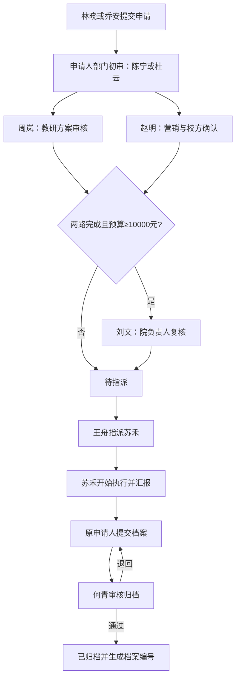

# 全角色流程测试计划

日期：2026-10-22。用途：由测试人员手动执行；本文件中的用例均为待执行。

**分两批执行：A～H 验证完整业务闭环；M 验证本轮多流程模板实现，在完成数据库迁移后执行。** 本轮已接入活动模板选择，开始前请先执行 `pnpm db:migrate` 并确认管理员模板库的发布状态。

账号和配置基线来自2026-10-21 17:34（北京时间）的只读数据库核对：已发布配置 V1、11个账号启用、当时密码均为123456、当时无活动工单。本计划未再次连接数据库；执行前先做 P00，账号若已调整以最新配置为准。

## 1. 测试准备

1. 用已经启动好的本地系统，测试人员自行打开登录页面；本计划不启动服务、不初始化数据库、不改密码。
2. 标题统一加 `[UAT-20261022-R1-用例编号]`。第二次执行改为 R2，避免混淆。每个异常用例新建一条独立活动，记录系统生成的工单编号。
3. 不同角色使用独立浏览器用户空间或不同浏览器；同一浏览器的普通窗口与多个标签共享登录，不适合并行角色验证。单人顺序测试可每次退出后登录另一个账号。
4. 下文 T0 是该条活动创建时刻。计划开始设 T0＋20分钟，结束设 T0＋80分钟。提交及重提时计划开始仍要在未来；到执行步骤必须等到计划开始时间后再点“开始执行”。测试审批较久时，在可编辑阶段调整计划时间。
5. 汇报实际开始取已发生时间，实际结束取当前时间前1分钟；实际开始≤实际结束≤当前时间。点击开始后至少过几分钟再汇报，避免填入未来时间。
6. 附件准备三份真实有效 PDF，分别作为申请资料、执行记录、成果资料；详见配套测试数据目录的样例。不同阶段独立上传。示例链接 example.com 只用于格式校验，归档“资料可访问”需要使用已上传的真实文件。

## 2. 全部账号与分工

应用登录统一初始密码：`123456`。这不是 MySQL 连接密码。

| 姓名 | 登录账号 | 部门 | 角色 | 必须实际参与的步骤 |
| --- | --- | --- | --- | --- |
| 许言 | admin | 公司 | 配置管理员 | P00核对配置；G、M配置用例 |
| 林晓 | linxiao | 教研一部 | 申请人 | A01发起、补档、提交归档；D/F异常 |
| 陈宁 | chenning | 教研一部 | 部门审核人 | A01部门初审；F取消审批 |
| 周岚 | zhoulan | 教育研究院 | 教研审核人 | A01、B01教研审核 |
| 赵明 | zhaoming | 营销中心 | 营销审核人 | A01、B01营销审核 |
| 刘文 | liuwen | 公司 | 院负责人 | A01高预算复核；B01验证跳过 |
| 王舟 | wangzhou | 教育研究院 | 流程负责人 | A01/B01指派；E动态调整/转交 |
| 苏禾 | suhe | 教研一部 | 执行人 | A01/B01开始执行和汇报 |
| 何青 | heqing | 教育研究院 | 归档审核人 | A01退回档案/审核通过；B01归档 |
| 乔安 | qiaoan | 教研二部 | 申请人 | B01完整发起和归档 |
| 杜云 | duyun | 教研二部 | 部门审核人 | B01部门初审；权限隔离验证 |

共9种角色、11个账号，不能用 admin 代替业务角色。admin 只具有配置管理权限；申请人从“活动工单”办理本人档案，当前没有“我的待办”菜单。

## 3. 当前默认流程

## 4. 可以照抄的申请数据

### A01：一部高预算活动

| 字段 | 填写值 |
| --- | --- |
| 活动名称 | [UAT-20261022-R1-A01] 立体阅读教研交流活动 |
| 举办方式 | 混合 |
| 开始/结束时间 | T0＋20分钟 / T0＋80分钟 |
| 活动地点／学校 | UAT测试学校一部报告厅 |
| 线上会议链接 | https://example.com/uat/meeting/a01 |
| 业务性质 | 校园立体阅读课程项目 |
| 服务类型 | 收费课题培训 |
| 活动背景与诉求 | 围绕整本书阅读教学开展联合教研，验证申请、并行审核、预算复核、执行与归档的完整闭环。 |
| 活动议程及内容 | 教研目标说明10分钟；专家专题分享20分钟；课例研磨20分钟；交流与成果整理10分钟。 |
| 内容形式 | 专题讲座、课例研磨 |
| 是否附带三峡大讲坛 | 否 |
| 参与人数 | 80 |
| 人员构成 | 教研员、一线教师 |
| 培训需求 | 阅读教学专题培训，线上线下混合开展，共60分钟，含讲座与课例讨论。 |
| 人员需求 | 1名阅读教学专家、2名现场协助人员；使用测试资料。 |
| 联系人 / 联系方式 | 林晓 / linxiao@example.com |
| 筹备人 / 联系方式 | 王舟 / wangzhou@example.com |
| 接待人 / 联系方式 | UAT测试校方联系人 / receiver@example.com |
| 专家费 / 会务费 / 差旅费 | 8000.00 / 2500.00 / 1500.00 |
| 预算总额 | 自动得到12000.00，不手工覆盖 |
| 申请附件 | 01-申请资料样例.pdf |

### B01：二部低预算活动

除下面字段外，照抄 A01；时间按 B01 自己的 T0 重填。

| 字段 | 替换值 |
| --- | --- |
| 申请人 | qiaoan |
| 活动名称 | [UAT-20261022-R1-B01] 教研二部线上阅读研讨 |
| 举办方式 | 线上；地点字段隐藏 |
| 线上会议链接 | https://example.com/uat/meeting/b01 |
| 服务类型 | 免费课题服务；培训需求隐藏 |
| 参与人数 | 30 |
| 联系人 / 联系方式 | 乔安 / qiaoan@example.com |
| 专家费 / 会务费 / 差旅费 | 5000.00 / 2000.00 / 1000.00 |
| 预算总额 | 8000.00 |

### 意见、汇报与档案数据

| 场景 | 填写值 |
| --- | --- |
| 部门审批通过 | 活动目标与部门安排一致，同意开展。 |
| 教研审批通过 | 培训内容与教研目标一致，同意方案。 |
| 营销审批通过 | 校方联系人与场地安排已确认，同意开展。 |
| 院负责人通过 | 预算12000元，费用构成清楚，同意立项。 |
| 指派执行意见 | 请苏禾负责现场与线上协作，按议程组织并整理成果。 |
| A01执行实到 / 支出 | 76 / 11800.00 |
| A01执行摘要 | 已完成阅读教学专题分享与课例研磨，参会人员完成交流并形成教研改进清单。 |
| A01异常说明 | 4名教师临时请假，实际支出低于预算200元。 |
| B01执行实到 / 支出 | 28 / 7800.00 |
| B01执行摘要 | 已完成线上阅读研讨，整理形成课堂实践建议和后续教研计划。 |
| B01异常说明 | 2名教师临时请假，实际支出低于预算200元。 |
| A01首次档案摘要 | 本次活动完成专题培训与课例研磨，已汇总教研建议、参会情况及费用说明，申请归档。 |
| 档案退回原因 | 请在成果摘要中补充参会缺席及费用差异说明。 |
| A01补充后档案摘要 | 本次活动完成专题培训与课例研磨，实到76人；4人请假，实际支出11800元，较预算节约200元，资料已完整整理。 |
| B01档案摘要 | 本次线上研讨已完成，会议记录、教学建议与费用说明已整理，申请归档。 |
| 归档通过意见 | 活动信息、成果资料和费用说明已核对，审核归档通过。 |

执行阶段上传02-执行记录样例.pdf；归档阶段上传03-成果资料样例.pdf。归档不能仅依赖申请或执行阶段附件。

## 5. P00：执行前核对（admin，随后全部账号）

1. admin 登录“配置中心”，记录已发布配置版本，确认11人启用、所属部门和角色与上表一致；只查看，不点发布。
2. 核对一部负责人陈宁、二部负责人杜云；进入“流程模板”，核对标准教研活动已发布且启用，默认流程为部门初审 → 教研/营销并行 → 预算≥10000元院负责人复核。
3. 依次登录其余10个账号，核对右上角姓名、菜单和可见范围，确认123456能登录；将不一致项记录为阻塞。
4. admin 应能配置，不能审批工单；linxiao、qiaoan 有“发起活动”；heqing 有“活动档案”；申请人没有“我的待办”属于当前设计。
5. 各账号退出重登一次，确认不会看到上一个账号的头像、菜单、待办或缓存详情。

## 6. A01：完整高预算闭环（优先执行）

| 步骤 | 使用账号 | 页面与操作 | 预期结果 |
| --- | --- | --- | --- |
| 1 | linxiao | 发起活动，选择“教研交流 / 标准教研活动”，填写A01基础信息、内容与预算；保存草稿 | 草稿仅本人可编辑，预算12000.00，记录工单编号 |
| 2 | linxiao | 上传01申请PDF；下一步至“检查并提交”，点“计算实际路线” | 显示陈宁、周岚、赵明、刘文；刘文不跳过 |
| 3 | linxiao | 提交申请 | 状态“审批中”；只有陈宁当前可办理 |
| 4 | chenning | 我的待办 → 进入工单 → 对部门初审点“办理”，选通过并填写部门意见 | 部门完成；同时生成周岚、赵明两个待办 |
| 5 | zhoulan | 通过教研方案审核 | 教研完成；营销待办保留；刘文尚不可办理 |
| 6 | liuwen | 查看本活动进度 | 院负责人节点等待，不能提前审批 |
| 7 | zhaoming | 通过营销与校方确认 | 两路汇合，刘文待办激活 |
| 8 | liuwen | 通过院负责人复核 | 所有必办审批完成，状态“待指派” |
| 9 | wangzhou | 活动工单 → 指派执行人，选苏禾，填写指派意见 | 状态“待执行”，苏禾成为执行人 |
| 10 | suhe | 在计划开始前尝试“开始执行” | 明确提示未到计划开始时间，仍为待执行 |
| 11 | suhe | 到计划开始后点“开始执行” | 状态“执行中”，记录实际开始 |
| 12 | suhe | 上传02执行PDF，按上表填写A01汇报；实际结束须已发生，提交执行汇报 | 状态“待提交档案”；其他角色不能代替汇报 |
| 13 | linxiao | 本人工单上传03成果PDF，填写首次档案摘要，提交档案 | 状态“待归档审核”，生成档案版本1 |
| 14 | heqing | 查看档案附件和汇报，点“退回档案”，填写退回原因 | 回到“待提交档案”，历史保留首次提交与退回意见 |
| 15 | linxiao | 填写补充后摘要，确认成果附件仍有效，重新提交档案 | 档案版本2；无需重新走部门/教研/营销审批 |
| 16 | heqing | 审核归档，仅勾选三项核对中的两项，尝试提交 | 提示核对不完整，不生成档案编号 |
| 17 | heqing | 全部勾选，填写通过意见并确认 | 状态“已归档”，生成档案编号，不能重复办理 |
| 18 | heqing、wangzhou、linxiao | 查看档案/导出/下载各阶段文件，核对申请、审批、执行、档案记录 | 内容一致，76人、11800元、档案版本及完整审计可追溯 |
| 19 | suhe、zhoulan等 | 查看历史，尝试旧待办/执行动作 | 已办结果可看，旧操作不能再次生效 |

何青的三个核对项：活动信息与执行情况一致；成果资料完整且可访问；费用与异常情况已说明。

## 7. B01：二部低预算闭环（让其余账号参与）

1. qiaoan 选择“教研交流 / 标准教研活动”（此处验证同一标准模板低预算跳过），用 B01 数据保存草稿、上传申请资料、预览并提交；预算8000，部门受理人为杜云，刘文节点显示“跳过”。
2. chenning 登录，检查没有 B01 待办，也无法打开 B01 工单；duyun 能看到并办理本部门初审。
3. duyun 通过部门初审，zhoulan 和 zhaoming 分别通过并行审核。
4. 两路通过后直接“待指派”；liuwen 没有此活动审批待办，也不能因“院负责人”身份越过数据范围查看未参与工单。
5. wangzhou 指派 suhe；苏禾虽在一部，因为获得执行任务，应能执行二部活动。
6. suhe 到计划开始后启动，上传执行记录，用B01的28人、7800元提交汇报。
7. qiaoan 上传成果PDF、填写B01档案摘要并提交；linxiao不能代办。
8. heqing核对三项并通过归档，记录档案编号。
9. qiaoan可查看本人A01以外的B01，linxiao可查看本人A01；两位申请人彼此不能读对方活动。

完成 P00＋A01＋B01 后，11个账号都实际参与过至少一项授权操作。

## 8. C：表单、金额和时间边界

### C01：院负责人预算临界值

每组另建活动，用 A01 数据，费用改如下；预览后实际提交并通过部门、教研和营销审核。

| 子用例 | 专家费 | 会务费 | 差旅费 | 合计 | 预期 |
| --- | --- | --- | --- | --- | --- |
| C01-1 | 8000 | 1500 | 499.99 | 9999.99 | 刘文跳过，直接待指派 |
| C01-2 | 8000 | 1500 | 500 | 10000.00 | 刘文必须审核 |
| C01-3 | 8000 | 1500 | 500.01 | 10000.01 | 刘文必须审核 |

### C02：一条草稿逐项修改验证

1. 名称清空、人数0、人数小数、负费用、费用三位小数，分别提交，逐项提示后恢复合法值。
2. 结束早于开始、计划开始已过去，提交被阻止；修复时间后可提交。
3. 切“线下”：地点必填，会议链接隐藏；切“线上”：链接必填且HTTPS，地点隐藏；切“混合”：两者必填。
4. 服务类型选“收费课题培训”：培训需求必填；改为免费后隐藏，服务端不把隐藏的旧内容当作有效新提交字段。
5. 修改三项费用，合计准确到分；只读预算不可作为绕开条件复核的入口。
6. 联系方式填无效文本，提示后改为样例邮箱；勾选多项内容形式和人员构成，保存重开仍完整。

## 9. D：退回、撤回、拒绝

### D01：并行审核中退回重提

1. linxiao另建A01副本数据，标题D01，提交；chenning通过。
2. zhoulan先通过；zhaoming选择“退回补充”，意见“请补充校方接待联系人及场地安排。”。
3. 状态待补充，本轮所有未办待办失效；已通过意见保留。
4. linxiao修改接待信息；若计划开始已过去，一并改到未来。预览并重新提交。
5. 申请版本增加，部门初审重新开始，不能直接从营销节点接着走。
6. chenning、zhoulan、zhaoming、liuwen按新一轮办理；旧轮次待办不能重复通过，历史可切换查看。

### D02：申请人撤回

1. linxiao新建D02提交；在审批中点“撤回申请”。
2. 状态已撤回；审核人手里的旧任务失效。
3. linxiao编辑、预览、重新提交，生成新申请版本，从部门初审重新走。

### D03：拒绝与复制

1. linxiao新建D03提交，chenning选择“拒绝”，意见“本次活动资源与排期不满足开展条件。”。
2. 状态已拒绝，申请人不能把原单当草稿重提。
3. linxiao“复制为新申请”，得到新工单ID；重新填写计划时间，核对业务字段，附件重新上传。
4. 新单可正常提交；原单保持拒绝结果和意见。

## 10. E：单场动态流程调整（wangzhou操作）

各用例单独创建活动；需记录调整前后结构版本、节点/个人待办及原因。

| 编号 | 前置与详细操作 | 预期结果 |
| --- | --- | --- |
| E01 前插 | 用8000元数据提交并通过部门；王舟新增“专项复核”，审批/指定刘文，参考教研节点，位置“之前”，原因“本次活动需补充专项负责人复核。”；刘文通过后再由周岚办理 | 教研原待办撤销，等待新节点；营销不受影响；院负责人原预算节点仍跳过；新专项审批必须完成 |
| E02 后插 | 用8000元数据通过部门；王舟在部门之后插“材料整理”任务，指定王舟，原因“部门审核后需先补齐活动准备材料。”；王舟办理任务 | 教研和营销原待办失效并等待，任务完成后生成新一代待办；部门既有通过意见保留 |
| E03 并行 | 用12000元数据通过部门；王舟与教研并行新增“技术准备”任务，指定苏禾；先让周岚、赵明通过，再让苏禾完成任务 | 刘文需等技术任务也完成再激活；办理准备任务不等于已被指派为执行人 |
| E04 知会 | 用8000元数据通过部门；在教研之前插知会给王舟，不办理知会；教研和营销正常通过 | 知会不阻断，活动进入待指派；审批关闭时未办知会任务撤销，不能要求它一直悬挂 |
| E05 转交 | 用一部活动，部门通过后，王舟将周岚教研待办依次尝试转给苏禾、杜云，最后转给赵明；原因“原审核人临时外出，转交其他有权限人员。” | 苏禾无审批权限，杜云数据范围不覆盖一部，两者被拒绝；赵明转交成功，分别办理教研与营销两项任务；周岚旧待办失效，保留转交审计 |
| E06 不合法调整 | 已完成部门节点前插新审核；或让新增节点依赖自身/后继形成环 | 明确拒绝，不破坏已有通过记录，不产生孤立/重复待办 |

## 11. F：取消活动

### F01：待指派阶段取消

1. linxiao新建活动并走完审批至待指派，申请取消，原因“合作方调整安排，本次活动拟取消。”。
2. 进入取消审批中，chenning收到取消审核；取消审核权限不由申请人自己承担。
3. chenning拒绝，意见“合作方仍可按计划开展，请继续推进。”；恢复待指派。
4. linxiao再申请取消，然后撤销取消申请；恢复待指派。
5. linxiao第三次申请取消，chenning批准；状态已取消，不能再指派执行，可复制新申请。

### F02：执行中取消

1. 另建活动走到suhe开始执行。
2. linxiao或wangzhou申请取消，先不填处置说明，预期提示补充。
3. 处置说明填“已通知参与人员停止开展，现场资料和费用由执行人统一清点。”；提交后chenning批准。
4. 活动已取消，原执行汇报入口不能继续产生正常档案；审计保留实际开始、取消原因和处置说明。

## 12. G：配置能力回归（独立于A/B，最后执行）

这些操作会改变已发布配置，只用于本地测试环境；每项完成后恢复业务配置并发布新版本，不能把版本号倒回。

| 编号 | 操作步骤 | 预期结果 |
| --- | --- | --- |
| G01 表单/流程发布 | admin先在动态表单添加可选字段uat_note并发布全局配置；再到标准教研模板添加部门后任务“测试材料核对”给王舟，先仅保存模板草稿，再发布模板。分别新建活动比较。用另一条发布前已提交活动作对照 | 仅草稿时新申请用旧发布配置；发布后新提交用新字段/节点；在途旧快照不变。旧单退回重提时使用最新配置；结束后在表单页删除测试字段并发布，再在模板删除测试节点并发布新版本恢复 |
| G02 多人会签 | admin临时给赵明增加教研审核角色，保留营销角色并发布；新建12000元活动，通过部门。赵明先只通过教研，再周岚通过，赵明另办营销 | 教研节点必须两人都通过才完成；院负责人等全部前置。完成后恢复赵明原角色并发布 |
| G03 停用/转交 | 新建活动激活周岚待办；admin停用周岚并发布；尝试周岚登录/旧会话办理，王舟查看异常并转交赵明；恢复周岚启用并发布 | 停用人员不能登录/办理；待办不会自动跳过；转交成功并审计；重新启用不自动收回已转交任务 |
| G04 动态菜单 | admin新增“UAT活动看板”，组件选活动列表，仅授权流程负责人，发布；王舟与申请人分别查看；再停用/清理并发布 | 只有授权角色看到菜单；直接访问同样受控；增加菜单不自动增加审批/发布权限 |

## 13. H：权限、并发、文件、消息、移动端

| 编号 | 详细步骤 | 预期结果 |
| --- | --- | --- |
| H01 权限 | 复制A/B详情地址，申请人互访、部门跨部访问、admin访问活动；尝试跨范围附件下载和导出。苏禾只在获得任务/执行身份后查看 | 权限和数据范围由服务端统一约束；禁止越权阅读、审批、下载或导出 |
| H02 并发 | 周岚和赵明独立会话同时通过并行任务；另用同一账号两标签对同一待办先后通过 | 两路意见均保留，只产生一份下一节点待办；重复操作返回已办理/版本冲突，无重复节点 |
| H03 附件 | 分别上传正常PDF；尝试空文件、超过20MiB、同阶段第11个文件、把纯文本改名.pdf；跨阶段/跨角色上传 | 正常文件可下载且内容正确；超限/签名伪造/越权失败；每阶段最多10个，单文件>0且≤20MiB |
| H04 消息 | 生成一个新待办，接收人打开消息；关闭后约10秒再打开，办理后核对工单与待办 | 通知指向正确活动；避免把当前刷新式消息列表误判为实时推送 |
| H05 PC/H5与画布 | PC正常宽度和390×844视口分别申请/审批/汇报；全屏画布、Esc退出、适配、100%、缩放、方向切换、定位节点 | 操作入口可达，无遮挡；正常100%时UI字体≥12px；画布不自动无限放大。手机实机访问另需配置局域网地址，手机127.0.0.1指向手机自身 |
| H06 六位密码 | 单独最后执行：苏禾从账号页改为654321；退出后验证旧密码失败、新密码成功；admin重置回123456 | 六位密码可用、旧会话按系统规则失效，恢复后不影响后续测试 |
| H07 超时提醒 | 单独建立未办工单持续观察：24小时受理人提醒、48小时流程负责人提醒，记录实际观察时间 | 定时扫描后产生对应提醒，不自动通过或越权升级；此项独立长周期测试，不修改生产时间戳或系统时钟 |

## 14. M：多模板新增验收（本轮已实现，待人工执行）

这些用例验证本轮新增接口和页面，均尚待人工执行；迁移后按实际部署版本记录结果。

| 编号 | 操作与数据 | 预期结果 |
| --- | --- | --- |
| M01 模板库 | admin建立并发布标准教研、线上公益研讨、收费培训、内部分享4模板，类型/范围按设计文档 | 4个独立模板ID/版本，默认推荐唯一；复制模板不共用可变节点对象 |
| M02 拖拽设计 | 从节点库拖“审批”至指定节点前/后/并行接入；编辑受理人、条件；移动画布节点；用前置选择调整依赖 | 结构与连线同步；仅移动位置不改变顺序；存在循环或缺少必要审核不能发布 |
| M03 不同路线 | linxiao选标准教研＋12000；qiaoan选线上公益＋8000；另建收费培训＋8000 | 标准高预算含刘文；线上仅部门/教研；收费即使低预算也含院负责人。依据最终确认规则验收 |
| M04 实例隔离 | 两场选择同模板V1；王舟只给活动A加签刘文，再创建活动C | 只有A新增节点；B、C以及模板V1定义不变 |
| M05 版本冻结 | 先提交V1活动；admin编辑并发布V2；另开新活动；V1继续办理 | 旧活动显示V1并走原图，新活动走V2；模板编辑不改历史意见 |
| M06 提交冲突 | 申请人预览V1停在提交页；admin发布V2；申请人提交 | 提示模板已更新，重新预览确认；不静默使用不同版本，不生成半条流程 |
| M07 停用 | 草稿选择模板后admin停用；尝试草稿提交、在途办理、退回重提 | 草稿提交被阻止并可换模板；在途继续；重提需选择有效模板 |
| M08 授权 | 模板仅授权一部；qiaoan尝试列表/详情/直接提交该模板 | 列表无可用入口，直接提交同样拒绝；临时获得审批任务不等于拥有模板选择权 |
| M09 表单变化 | 动态表单增加必填字段并发布，再发布模板新版本；旧单退回重提，保留旧申请版本 | 提示补齐并重新预览；旧版本表单仍可回放，无未知条件字段 |
| M10 迁移/H5 | 迁移现有全局流程一次再重复迁移；H5选择与PC同模板预览 | 只生成一份默认模板，旧工单不重建待办；两端路线和权限一致 |

## 15. 状态速查

草稿draft → 审批中approving → 待指派ready_assign → 待执行ready_execute → 执行中executing → 待提交档案archive_draft → 待归档审核archive_review → 已归档archived。

分支：退回needs_info、撤回withdrawn、拒绝rejected；取消审批cancel_review → 批准cancelled，拒绝/撤销恢复取消前状态。

## 16. 完成标准与记录

1. P00、A01、B01全部通过，11个账号均实际参与；记录两条工单及档案编号。
2. C～H逐项记录通过/失败/阻塞/未执行，失败有角色、步骤、截图、预期与实际；不能把未执行记为通过。
3. 所有审批意见、转交原因、实例调整和归档版本可追溯；无重复待办、越权和实例串线。
4. 配置异常用例结束恢复组织/菜单/角色/表单及默认流程，保留发布历史。
5. M系列单独记录“未执行”，人工完成后再填写结果。
6. 如果登录、详情页或动态菜单页无法使用，先记录阻塞和复现步骤，处理后再执行相关用例，不能把未完成操作记为通过。

执行表见 [测试执行记录](测试数据/测试执行记录.md)，字段键和值见 [测试数据JSON](测试数据/全角色测试数据.json)。
