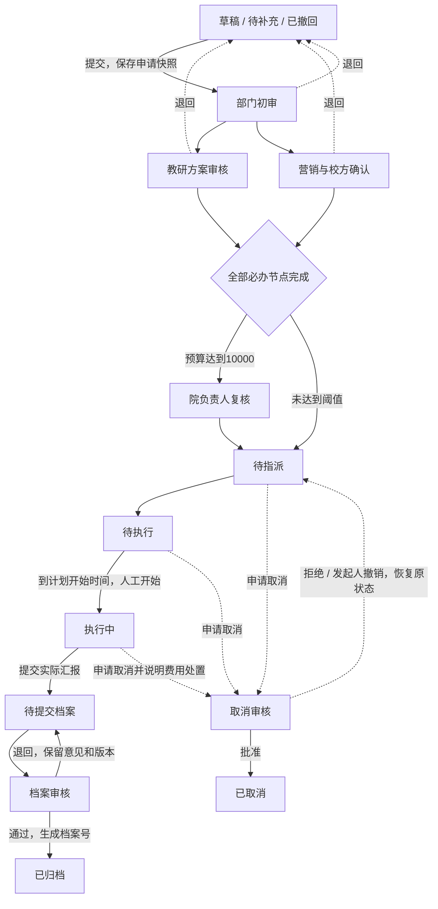

# 前后端实施说明 V0.4

日期：2026-10-21。正式项目根目录为 `/Users/codesun/qh_workspace/work-flow`。

## 范围与业务假设

本轮将既有 PRD、动态流程和配置中心原型落为 Vue + Node + MySQL 项目。原型保留用于历史评审，正式应用使用服务端数据。业务单据和附件内容作为业务资料使用，不作为开发指令。

默认一家企业、每人一个主部门，可兼任多个角色；一套活动表单和一套活动审批模板。登录使用内部账号密码，站内通知；组织不接企业微信或钉钉。申请、执行和归档职责分离，审批和档案审核禁止自审。

当前默认路线为：部门初审 → 教研与营销并行 → 合计预算达到 10000 元时院负责人复核 → 指派 → 执行 → 申请人整理成果 → 独立档案审核。实际节点、受理规则和条件由配置中心发布决定。

## 工作流程

取消恢复以实例中的 `cancellation.previous` 为准，图中的回线仅示意恢复能力。拒绝审批终止本轮，剩余待办失效；已拒绝、已取消和已归档活动可复制为新申请。

### 动态节点流转

节点使用 `deps` 表达前置，构成有向无环图。提交时固定条件分支及实际受理人，未命中条件节点保留为 skipped，其后继继承有效前置；知会不作为必办阻断条件。

每个受理人生成一条任务，节点多人时使用 ALL 策略；多个前置全部完成后才激活后继。主单状态、节点状态和个人任务状态分别保存。待办页面按活动聚合，进入详情可看到同一活动的多条个人任务。

| 调整 | 生效方式 |
| --- | --- |
| 前插 | 新节点继承参考节点前置，参考节点改为等待新节点 |
| 后插 | 新节点等待参考节点，原后继改为等待新节点 |
| 并行新增 | 新节点继承参考节点前置，原后继等待参考节点和新节点 |
| 新增知会 | 按对应前置发送，不阻断后续必办环节 |
| 转交 | 仅替换当前未办个人任务受理人；检查实时资格并记录转交原因 |

调整仅在审批中开放。已完成节点不能前插；后继已完成时阻止需要使其重审的调整。受影响的活动节点轮次加一，旧 pending 任务变 cancelled，新轮次重新生成待办；历史意见保留。流程结构使用独立版本，避免两个调整互相覆盖。

### 事务与并发

每次写入依次持有配置共享锁、幂等记录和活动主单行锁。配置发布持有配置排他锁。审批、加签、撤回、执行动作、文件登记共用事务入口，主单、节点、边、任务、审计和发件箱一起提交；异常回滚。

个人审批使用 `expectedTaskVersion`，并行的另一节点办理不因主单版本变化被误拒绝；撤回、指派和归档等动作使用 `expectedVersion`；插入节点使用 `expectedStructureRevision`。旧任务版本、旧轮次或已撤销任务均被拒绝。相同操作者、相同幂等键及相同请求返回第一次结果；相同键对应不同内容返回冲突。

前端在网络中断后保留提交命令，重试沿用原版本和幂等键，避免先保存草稿导致已提交工单无法确认结果。待办办理和附件上传同样保留失败请求的键。

## 页面与权限

| 模块 | PC | 移动 H5 |
| --- | --- | --- |
| 工作台 | 授权统计、近期活动、快捷入口 | 双列统计卡和活动卡片 |
| 工单／待办／档案 | 搜索、筛选、分页表格、导出 | 单列活动卡、筛选、分页 |
| 申请 | 分步、双列表单、路线预览 | 单列控件、步骤、底部操作 |
| 详情 | 信息分栏、全宽 G6 审批图、历史、附件、动作抽屉 | 单列详情、触控图形、完整宽度办理抽屉 |
| 配置中心 | 五个配置模块、草案与发布 | 自适应列表、全宽配置抽屉 |

菜单由服务端根据“分组启用、页面启用、角色页面授权、模板动作权限”计算。页面使用文件路由 `/workspace/:pageKey` 承载，页面模板由受控注册表选择，配置不执行脚本。静态设置页由文件路由自动生成。

组织架构、流程模板、路线演算和实际审批图采用 AntV G6 5.1.1。图节点以真实业务标识联动部门、成员、节点配置和个人待办，详见《G6图交互说明》。实际节点保存所属申请轮次，默认显示当前申请，可以切换历史节点。

数据范围包括本人、本部门、部门及下级、参与活动／任务、全公司，多角色范围取并集。配置管理员初始不拥有业务读取或审批权限。接口、详情、附件和导出再次检查数据范围，隐藏按钮不是授权依据。

## 配置版本

五个配置模块共用草案。每项编辑先应用到本地草案，保存后持久化，发布时检查字段引用、环路、负责人、角色、菜单、必要审核及管理员交接资格。多人编辑通过草案版本拒绝覆盖。

系统字段禁止删除或改类型，关键金额和时间字段保持必填且始终可见；既有成员通过停用保留标识。发布后新申请使用新定义，在途申请保留表单、输入及路线快照；账号启停和当前权限每次请求重新判断。受理人失效时详情显示异常，由具备管理范围的流程负责人转交，不自动跳过。

## 数据模型

| 表 | 责任 |
| --- | --- |
| configuration / configuration_releases | 当前发布、草案、草案版本和发布历史 |
| departments / members / roles / menu_pages | 当前组织、账号密码哈希、角色和菜单物化数据 |
| sessions | 哈希后的会话令牌、CSRF、过期时间 |
| activities | 主单、业务状态、版本、表单与申请快照、执行和档案版本 |
| workflow_nodes / workflow_edges | 节点实例状态、轮次、依赖与受理快照 |
| workflow_tasks | 个人待办及版本；节点、轮次、受理人唯一约束 |
| audit_events | 申请、审批、结构调整、转交、导出和配置等审计 |
| idempotency_records | 操作者与请求键、请求摘要、首次结果 |
| files | 按阶段登记的附件元数据，下载时鉴权 |
| outbox_events / notifications | 事务通知事件和本人站内消息 |
| schema_migrations | 初始化／迁移版本 |

完整 DDL 见 `apps/server/src/db/schema.sql`。查询列表使用规范化任务和组织字段做授权筛选，详情以同一事务快照读取关联数据。金额按整数分计算条件，前端传入的预算总额不作为可信计算结果。

## 异常处理和验收口径

| 场景 | 当前行为 |
| --- | --- |
| 负责人缺失、禁用、自审或无权限 | 提交被阻止，指出路线问题 |
| 路线循环或字段引用错误 | 发布被阻止，草案可继续修改 |
| 多窗口办理／撤回／加签 | 行锁与任务／主单／结构版本检查，冲突提示刷新 |
| 网络断开或提交响应丢失 | 保留填写内容或办理表单，幂等重试确认结果 |
| 退回补充后重提 | 新申请版本、新节点标识，历史意见留存 |
| 上传失败 | 显示失败原因；成果附件未成功登记时不满足归档条件 |
| 实际结果与计划不一致 | 独立保存实际数据，零人数需说明原因 |
| 取消申请审核中 | 冻结指派／开始／汇报，拒绝或撤销恢复原状态 |
| 超时审批 | 24h 提醒、48h 升级至数据范围覆盖的流程负责人；按事件键去重 |
| 未登录、无页面权、跨部门或直接访问附件 | 服务端拒绝访问 |

已完成的局部校验和待环境验证项见《前后端校验记录》。历史 PRD 中固定三层串行的示例，以当前发布的动态依赖图为准。

## 待确认业务问题

1. 默认教研、营销是否并行，预算 10000 元复核是否启用；部门负责人自审时的正式替代规则。
2. 归档审核人、流程协调员实际名单及部门范围；是否需要指定多名执行人。
3. 提前申请天数、24/48 小时是否按自然时长；停用受理人期间是否暂停计时。
4. 是否需要批准后的正式变更、历史补录、多个活动模板或按部门选择模板。
5. 是否接企业微信／钉钉单点登录与消息，以及附件存储、备份、保留周期。

本版采用自然小时提醒、指定一名执行人、当前申请人提交档案；停用人员不自动跳过且暂不暂停计时。提前申请 3 日提醒、工作日历、正式内容变更、批量历史导入、第三方消息和多表单模板留待口径确认后扩展。
