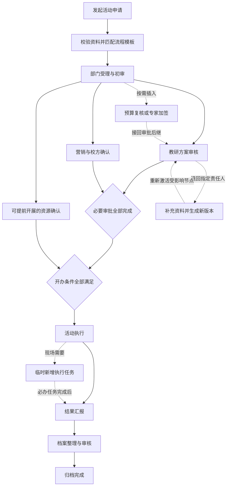

# 活动动态流程设计 V0.2

日期：2026-10-21 · 评审重点：流程可穿插、可新增，保持轻量

## 1. 本次调整

活动保留“申请、审批、筹备、执行、归档”的业务阶段，每场活动使用一份可独立调整的任务图。阶段用于理解进度；任务之间的前置条件决定谁能先办、谁能同时办、何时进入下一阶段。

本文覆盖 V0.1 PRD 中“默认固定三层串行、临时加签与会签延后、单一当前任务”的假设。原有活动字段、数据范围、禁止自审、申请快照、文件授权及审计要求继续适用。原三层链保留为一种标准模板，不再作为全部活动唯一走法。

此次交付的“动态流程图”是独立设计演示，可插入、并行、增加子流程并模拟办理；原活动工单页面仍使用 V0.1 的办理逻辑。设计演示的数据与工单数据分开，新增的流程节点不会被当成真实审批结果。

## 2. 工作流程全景

示意图展现可启用的路线。实际运行以实例任务图为准，启用加签时重接依赖，不能同时保留可绕过该加签的直接通路。可提前筹备的内容限定为不产生承诺、费用或实际开办的资源询期、需求确认；正式采购、费用承诺或现场执行须满足相应审批门槛。

## 3. 六种动态能力

| 能力 | 活动例子 | 系统行为 |
| --- | --- | --- |
| 条件选路 | 收费培训、大额预算、线上活动 | 提交时按条件选择节点，显示命中原因 |
| 串行插入 | 分管领导前增加预算复核 | 原前置 → 预算复核 → 分管领导；原直接依赖被替换 |
| 并行穿插 | 教研审核与营销确认同时办理 | 同时产生多个待办，默认全部必要分支完成后汇合 |
| 审批期间筹备 | 受理后提前询问专家档期和学校场地 | 受理完成后即可办理低风险任务，开办仍等审批与必要筹备完成 |
| 新增子流程 | 临时增加专项评审 | 插入“资料补充 → 专项审核”可复用任务组，有独立办理记录 |
| 执行中追加 | 补一次设备复核或补充培训反馈 | 挂在具体执行任务前后，必办则阻塞对应后继，知会则不阻塞 |

节点类型保持四种：审批、办理任务、知会、子流程。串行与并行用依赖关系表达；条件通过有限的字段比较表达，不引入任意脚本。MVP 汇合默认“全部必办通过”，或签、任意 N 人通过等规则后续再扩展。

## 4. 模板调整与在途调整

### 模板层

流程管理员维护活动类型模板，可增加节点、设置负责人解析方式、条件和依赖，发布新模板版本。新活动或明确选择重启审批的活动使用新版本，已提交活动不自动迁移。

### 单场活动层

流程负责人在当前活动中插入具体任务，必须填写名称、类型、负责人、位置、阻塞关系、原因。确认前显示受影响的待办与后继节点。只有这场活动发生变化，原模板不变。

建议权限：流程负责人可调整本活动未完成部分；当前审批人可在自己的激活节点前加签；申请人可提出新增环节请求，流程负责人确认后生效。知会人和普通查看人不可编排。系统管理员需另授流程负责人权限，才可变更单场活动。

## 5. 三种插入位置

| 位置 | 原关系 | 必办插入后的关系 | 当前任务影响 |
| --- | --- | --- | --- |
| 节点前 | 前置 → 当前节点 | 前置 → 新节点 → 当前节点 | 当前节点暂停，待新节点完成后恢复 |
| 节点后 | 当前节点 → 后继 | 当前节点 → 新节点 → 后继 | 当前节点继续，后继增加前置条件 |
| 与节点并行 | 前置 → 当前节点 → 后继 | 前置同时进入当前与新节点，二者完成才进入后继 | 形成多个有效待办，后继等待汇合 |

审批与审核子流程固定为必办，知会固定非阻塞；普通办理任务可以选择是否阻塞。知会与非阻塞协作不改变必办后继，但记录接收人与已读／完成情况。归档时未完成的非阻塞任务需明确关闭或保留为后续事项，并记录理由。流程设计演示中的“模拟完成归档”会自动将未完成非阻塞项标为随归档关闭，正式实现建议由归档确认页列出并人工确认。

## 6. 运行边界

1. 已完成的节点不可原地删除或改写审批意见；新节点只能影响未完成的后继。若需改变已生效的批准内容，发起变更单，按影响范围重审。
2. 未完成节点的“节点前”插入会撤销当前受理权并生成新任务依赖。处理人与编排人并发操作时，任务版本只允许一个事务成功。
3. 不允许循环依赖、悬空的必办节点、缺少负责人、自审和没有归档出口的流程。新增节点即使完成也要有明确的下一步。
4. 审批通过、资源到位、执行许可等必要门槛不能通过删除、改成知会或调整分支绕过。模板与实例都要执行门槛校验。
5. 退回要选择补充责任人、暂停范围与恢复点。默认仅暂停依赖该资料的分支，其他独立分支可继续；涉及预算、时间、对象等重要字段变更，重新激活受影响审核节点。
6. 驳回、撤回、取消会关闭对应未完成任务；取消审批中冻结对外执行。与取消无关的资料整理可按公司规则保留。
7. 同一个人可以收到不同节点任务，权限校验按任务执行；任务列表支持同时存在多条待办。
8. 提交申请快照与流程结构版本分别管理：内容 V2 与流程实例结构 R3 不是同一个版本。

## 7. 状态模型调整

主单展示业务阶段和汇总进度，不用一个“当前处理人”覆盖所有任务。

| 层级 | 建议字段／状态 | 用途 |
| --- | --- | --- |
| 活动 | phase=申请／筹备／执行／归档／结束；outcome=进行中／已完成／已取消／已拒绝 | 稳定呈现业务所处阶段 |
| 跨阶段摘要 | approval_status、preparation_status、active_task_count、blocked_task_count | 展示“审批中，同时有 2 项筹备进行中” |
| 任务 | 等待前置、待办理、处理中、暂停、已完成、退回、拒绝、取消、关闭 | 每个办理事项独立流转 |
| 任务依赖 | 必须完成、参考／知会；汇合默认全部满足 | 控制激活和阻塞 |
| 异常标记 | 逾期、缺少负责人、流程调整中、等待补充 | 不挤占业务主状态 |

PC 工作台呈现“待办节点”，同一活动可有多个办理项；详情展示流程图与并行任务列表。H5 以“我需要处理的任务”为入口，显示当前任务的前置、后继与加签入口；完整编排优先放在 PC，移动端保留轻量前加签和新增任务申请。

## 8. 数据模型增量

| 实体 | 关键字段 | 说明 |
| --- | --- | --- |
| WorkflowTemplateVersion | id、version、activity_type、node_definitions、edge_definitions、conditions、required_gates | 保留原模板版本机制，节点与依赖分开存储 |
| WorkflowInstance | id、activity_id、template_version_id、structure_revision、status | 一场活动的实际运行任务图 |
| WorkflowNodeInstance | id、instance_id、key、kind、parent_subflow_id、assignee_id、status、mandatory、payload_revision_id、task_version | 统一审批与办理节点，关联申请版本；多节点可同时激活 |
| WorkflowEdgeInstance | id、instance_id、from_node_id、to_node_id、dependency_type、condition_snapshot | 显式保存串行、并行与汇合关系 |
| WorkflowAdjustment | id、instance_id、before_revision、after_revision、operation、node_ids、reason、actor_id、created_at | 记录谁在何处新增／更换节点及受影响范围 |
| RequiredGate | gate_key、instance_id、required_nodes、business_condition | 活动开始与归档门槛，禁止普通节点调整绕过 |

原 Activity.current_task_id 改为查询当前激活节点集合；原 ApprovalTask 可以作为审批类任务的扩展表。调整结构需携带 expectedStructureRevision，办理任务需携带 expectedTaskVersion；一笔事务内校验依赖、更新任务图、生成／撤销待办、追加审计及通知事件。

## 9. 调整后的 MVP

P0 增加：模板节点增减与有限条件、实例前加签／后插入／并行任务、简单子流程、全部必办汇合、实例结构留痕、受影响待办重算。保留活动字段与原完整闭环。

P1 保留：复杂循环、任意脚本、可视化 BPMN、跨系统长事务、多种会签投票、跨子流程任意跳转。先把活动场景常用动作做好，避免通用流程平台的配置负担。

## 10. 动态流程验收增量

| 编号 | 场景 | 预期 |
| --- | --- | --- |
| DY01 | 在当前审批前加签 | 新审批先激活；当前审批等待，原审批不能继续处理 |
| DY02 | 在节点后插入必办任务 | 原后继依赖变为新节点，无法绕行 |
| DY03 | 在节点旁添加并行必办 | 多个待办并行；后继等待全部完成 |
| DY04 | 新增非阻塞知会 | 不阻塞主线，接收人仍可查记录 |
| DY05 | 新增专项子流程 | 内部任务顺序明确，子流程完成后原后继才激活 |
| DY06 | 审批与筹备穿插 | 允许资源询期；未满足审批门槛不能开始执行 |
| DY07 | 尝试修改已完成节点／形成循环 | 拒绝并提示具体原因，不改历史 |
| DY08 | 模板发布与实例新增 | 新模板只影响后续实例，单场新增不污染模板 |
| DY09 | 退回一条并行分支 | 相关后继暂停，独立分支按配置继续；重审范围可查 |
| DY10 | 完成操作与结构调整并发 | 仅一个版本成功，另一方取得最新图和任务状态 |
| DY11 | 同一活动有多条激活任务 | PC／H5 的待办逐项显示，不覆盖其他办理项 |
| DY12 | 取消／归档 | 必办门槛全部满足后才归档；取消关闭相关未完成任务 |

## 11. 需确认的业务决策

- 谁可以在单场活动中新增必办环节：流程负责人直接调整，还是申请人提出后审批？建议前者承担流程责任，申请人保留申请入口。
- 哪些审批节点和开办条件必须保留？建议由公司明确最少必要审核集合，其余按活动类型配置。
- 哪些筹备可以提前做？建议只开放无费用、无外部承诺的询期和资料准备。
- 退回是否暂停整场活动？建议按受影响依赖暂停；关键立项字段变更扩大重审范围。
- 执行中新增加签是否要暂停现场活动？建议按加签阻塞的目标明确选择，暂停范围在确认页展示。
