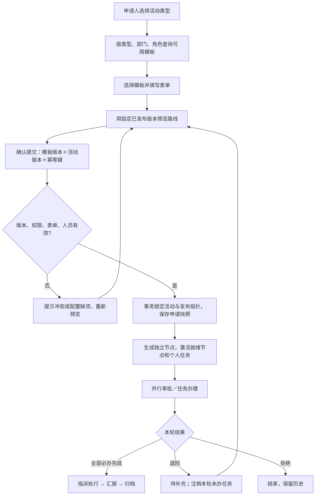

# 多流程模板与设计器需求设计 · V0.4

日期：2026-10-22。状态：核心功能已实施；配套离线原型仍独立于业务数据库。实施范围见《多流程模板代码实施说明》。

## 1. 本次纠正的设计边界

改造前的 CompanyConfig 只有一份 form 和 workflow，新建活动没有模板选择；提交服务统一调用这份 workflow。当前已支持 DAG 串并行、条件跳过、多人全员通过、单场活动插入节点、任务转交和申请版本快照，可以继续复用。

目标改为：**活动类型 → 可用流程模板 → 已发布版本 → 活动申请 → 独立流程实例**。管理员维护常用模板；申请人选模板；流程负责人处理单场例外。每个活动独立保存运行节点、个人任务和意见，单场调整不回写公共模板。

当前已完成 Vue、Node 与 MySQL 增量迁移代码，覆盖模板库、设计器、独立发布版本、活动选择及流程快照。未自动运行数据库迁移或浏览器验收。

## 2. 三个概念必须拆开

| 对象 | 用途 | 谁维护 | 修改影响 |
| --- | --- | --- | --- |
| 活动类型 | 业务分类，如教研、培训、校内分享 | 配置管理员 | 类型的可选模板、默认推荐 |
| 流程模板及版本 | 复用的表单引用、审批节点、条件和受理规则 | 配置管理员 | 发布后用于后续提交 |
| 活动流程实例 | 某一活动的冻结路线、任务、意见和调整 | 业务参与人、流程负责人 | 仅本场活动 |

活动类型与模板采用多对多：一个类型可以允许多种流程；一个通用流程也可以被多个类型复用。新建活动先选类型，再选允许使用的模板。已有“业务性质”和“服务类型”继续作为表单业务信息，避免和新“活动类型”混为同一字段。

第一阶段保留现有活动申请表，模板引用同一份表单，仍统一进入“指派 → 执行 → 汇报 → 归档”。后续再支持每模板绑定不同表单；系统必需字段和末端归档约束保留。

## 3. 建议的初始模板

| 模板 | 适用类型 | 审批路线 | 默认可用部门 |
| --- | --- | --- | --- |
| 标准教研活动（默认） | 教研交流、阅读项目 | 部门初审 → 教研与营销并行 → 预算≥10000元时院负责人复核 | 教研一部、二部 |
| 线上公益研讨 | 线上研讨 | 部门初审 → 教研审核 | 教研一部、二部 |
| 收费培训 | 收费培训 | 部门初审 → 教研与营销并行 → 院负责人复核（始终进入） | 教研一部、二部 |
| 内部分享 | 内部分享 | 部门初审 → 资料准备任务 | 教研一部、二部 |

以上是建议业务规则。是否允许线上活动省略营销审核、收费培训是否无条件由院负责人审核，需业务确认后发布；原型将其作为演示配置。公司最小治理规则暂定每条流程必须保留无条件的“部门初审”。

## 4. PC 页面与交互

### 4.1 模板库

配置中心新增“流程模板”，展示名称、编码、适用类型、范围、默认标记、当前发布版本、是否有草稿、启停状态、更新时间。

操作：新建、从现有模板复制、设计、预览、查看版本、设为类型默认、停用。已发布模板不能物理删除，支持归档；未发布且无引用的草稿可删除。复制生成新模板 ID，重新发布，不继承业务实例。

新模板默认由必要部门审核节点起步，使用现有表单；录入名称和适用类型即可开始设计。模板编码唯一且发布后固定。每个“活动类型＋部门范围”只能解析出一个默认模板；发生默认规则冲突时阻止发布。未配置默认但有多个模板时，由申请人明确选择。

### 4.2 G6 低代码设计器

三栏：左侧节点库，中间大画布，右侧节点属性。画布提供全屏、适配、100%、缩放、自动排列；界面字体最低12px，默认14px。保存后保留节点坐标，布局坐标与审批依赖分开存储。

- 左侧拖入审批、办理任务、知会；选中节点后，可前插、后插、并行新增。点击新增也能完成同样操作。
- 节点之间的连线代表前置依赖；正式设计器支持连线/删除线，右侧提供“前置节点”多选作为键盘等价操作。移动位置本身不改变审批顺序。
- 审批节点支持部门负责人、指定角色全部成员、指定人员；首期沿用全员通过。条件通过结构化字段配置，不允许用户填写可执行脚本。
- 多个前置全部完成才激活后继；多个无依赖入口同时启动。条件不满足的节点跳过并继承其前置。知会不会阻断后续。
- 结束节点是展示用汇合点，实际以所有必办节点终态判定结束。指派、执行、归档是公共业务阶段，第一阶段不开放随意删除。
- 编辑器提供撤销/重做、草稿保存、校验、路线演算、发布。发布前强制校验，保存草稿可保留尚未配置完整的节点。

本次离线原型演示：模板库、复制/新建、节点库拖入前后及并行接入区、节点属性/前置编辑、节点删除、条件演算、发布、模板选择和冻结实例。正式版自由连线、坐标持久化、撤销/重做列入开发验收，不将原型视为已完成接口。

### 4.3 活动申请

第一步增加“活动类型、流程模板”。只有一个可用模板时自动选中并显示名称；多个时显示默认推荐及备选，卡片展示审批摘要、版本和适用范围。

填写预算等字段后，点“预览审批路线”，展示实际人员、进入/跳过节点及原因。切换模板时提示审批路线变化，兼容字段继续保留；若后续绑定不同表单，先说明字段增减，再确认切换。

提交前服务端重新核对模板有效性、授权范围、最新版本、表单和实际人员。客户端提交 expectedTemplateVersion；若模板已更新，返回冲突，展示版本变更，要求申请人重新预览并确认后再提交。

活动详情固定显示“模板名 / 版本 / 申请版本 / 实例调整次数”，并区分模板原始节点和实例新增节点。申请人不能直接修改模板或任意更换审批人。

## 5. H5 范围

H5 支持活动类型和模板选择、路线预览、申请、审批、执行汇报、归档及必要的转交操作；模板卡片下方展示纵向审批摘要，画布可全屏。

模板设计放在 PC。H5 管理员可查看模板和发布状态，复杂编排引导到 PC。H5 与 PC 的选择权限、提交校验和运行结果完全一致。

## 6. 版本和状态规则

模板生命周期：新草稿 → 首次发布 → 有已发布版本＋可编辑草稿 → 发布新版本。启停是独立状态，不用一个 status 混淆“有草稿”和“可用”。

| 时点 | 采用规则 |
| --- | --- |
| 新建草稿 | 保存 templateId 和用户最近预览的 templateVersion；不创建待办 |
| 编辑已有活动草稿 | 检查模板仍可用；若更新版本，提示变化并重新预览 |
| 首次提交 | 锁定提交所选模板的当前发布版本，保存表单、节点、条件、受理规则快照 |
| 已提交后模板更新或停用 | 在途实例继续使用原快照；办理资格仍按当前成员有效性和权限校验 |
| 单场加签、转交 | 记录实例结构版本、原因、操作者；不修改 templateVersion |
| 退回/撤回后重提 | 第一阶段明确按该模板最新发布版本重新预览并确认，生成新申请版本；模板已停用则要求选其他可用模板 |
| 复制活动 | 创建新 ID，重新选取可用模板版本，清空执行、审批意见和时间；附件按当前复制规则不继承 |
| 历史模板版本 | 可查看，普通申请人不能任意选择过期版本绕开新规则 |

是否允许流程负责人审批后将某历史版本开放给新申请，作为后续扩展，不进入首期。首期也不支持对运行中的整条流程“一键切模板”；通过实例加签/转交处理。

## 7. 服务端流转

个人审批接口继续按 taskId、活动版本、任务版本办理，绝不依据前端传入的“下一节点”。服务端推进 DAG、处理条件和汇合，并由事务保证节点、待办、审计、通知发件箱一起提交。模板发布不重新计算在途活动。

并发发布与提交必须共享模板锁/版本控制协议：发布锁模板主记录，更新发布指针；提交读取并校验同一主记录的发布指针。提交失败时回滚待办和申请快照，重复幂等键返回同一次结果。

## 8. 数据模型

现有活动和任务结构保留，新增模板域，不把所有模板塞回一条全局配置记录。

| 表 | 关键字段与约束 |
| --- | --- |
| activity_types | id、code唯一、name、active、sort |
| workflow_templates | id、code唯一、name、active、draft_revision、current_version、created_by、updated_at |
| workflow_template_drafts | template_id唯一、definition_json、layout_json、revision、updated_by |
| workflow_template_releases | template_id＋version唯一、definition_json、layout_json、form_snapshot、published_by、published_at；发布后只读 |
| activity_type_templates | activity_type_id＋template_id、is_default、department_scope_json、allowed_roles_json；服务端校验默认覆盖冲突 |
| activities | 增加 activity_type_id、template_id、template_version；现有 schema/snapshots 保留 |
| application_revisions | 若仍内嵌存储，在 snapshots 中增加 templateId、templateVersion、templateName、activityTypeId、definitionHash |
| audit_events | 模板新建、复制、发布、停用、活动选择/切换模板、实例结构调整 |

templateVersion 与公司 configVersion 独立：前者定位流程定义，后者追踪组织/角色/菜单配置。不能以 configVersion 代替 templateVersion。受理人按提交时组织解析并冻结名单，办理时实时校验有效账号与审批权限；离职或停用交由流程负责人转交。

第一阶段 form_snapshot 复用全局动态表单，每次模板发布捕获可核对的表单定义；若表单更新涉及模板条件引用字段，要生成模板新版本一起发布。旧版本继续能回放。

## 9. 接口设计（实现路径以实施说明为准）

| 接口 | 作用 |
| --- | --- |
| GET /api/activity-types | 当前用户可用活动类型 |
| GET /api/workflow-templates?activityTypeId= | 已发布、启用且授权的模板摘要 |
| GET /api/workflow-templates/:id/versions/:version | 有权限的版本详情；申请预览只读 |
| POST /api/admin/workflow-templates | 新建或从现有版本复制 |
| PUT /api/admin/workflow-templates/:id/draft | 保存草稿＋expectedDraftRevision |
| POST /api/admin/workflow-templates/:id/validate | 结构/引用/规则校验，返回定位到节点的问题 |
| POST /api/admin/workflow-templates/:id/publish | 校验草稿并发布不可变新版本 |
| POST /api/admin/workflow-templates/:id/deactivate | 停用；界面提醒可能暂无可选模板，允许管理员明确停用 |
| POST /api/workflow-templates/:id/preview | 指定版本＋实际申请人＋表单，返回实际路线 |
| POST/PATCH /api/activities | 增加 activityTypeId、templateId、expectedTemplateVersion |
| POST /api/activities/:id/submit | 重新校验选择、版本与授权，事务实例化 |

模板管理沿用 config:manage，申请选择沿用 activity:create/submit。服务端同时校验类型、部门、角色和模板授权；能看菜单不等于能发布模板，能选模板也不等于拥有其审批角色。

## 10. 发布前校验与异常

必须阻止：重复节点 ID、自环或环路、缺失依赖、缺失必要部门审核、没有任何必办审批、非法字段条件、非数值字段用数值比较、受理规则引用不存在对象、没有可用受理人、审核人自审、办理权限或数据范围不覆盖。

模板发布时按其适用部门的代表申请人演算，报告空角色、停用负责人等问题。提交时再次针对实际申请人、当前表单和实时组织演算；人员缺失应提示流程负责人修复，禁止静默跳过必要审核。

条件分支首期沿用“节点是否进入”模式，多个条件可独立同时进入；互斥网关、优先级分支、默认分支、或签、子流程、脚本节点等列为后续能力，避免首期扩成通用 BPM 平台。若以后引入互斥网关，必须明确冲突优先级和默认兜底。

## 11. 实施顺序与迁移

1. 模板域类型、MySQL 增量迁移、默认模板导入。以固定迁移键将现有 workflow 导入“标准教研活动 V1”；已存在则跳过，禁止重复导入或重置密码。
2. 模板管理/版本/发布/授权接口；复用 domain 校验、人员解析和 DAG 引擎，将实例化入参从整份 CompanyConfig 拆为明确的模板定义与组织上下文。
3. 配置中心模板库、G6 设计器和发布校验；复用现有图组件但把编辑交互与只读办理图分开封装。
4. 申请页类型/模板选择、路线预览、详情版本标识，PC/H5 同步接接口。
5. 执行全角色回归及 M 系列多模板验收。

迁移旧活动时保留原有 nodes、tasks、申请快照和结构版本。旧快照没有模板版本的展示为“历史流程快照”，不伪造原始版本来源；为可编辑旧草稿推荐新默认模板，提交前由申请人确认。迁移不自动重新生成旧待办。

## 12. 验收标准

- 可同时发布至少4套模板，选择不同模板产生不同审批路线；线上研讨不会冒出营销待办。
- 拖拽、按钮新增和属性依赖编辑得到一致结构；环路、无资格受理人等问题可定位，不能发布。
- 同一模板 V1 运行中，发布 V2 后旧活动仍走 V1，新申请走 V2；并发提交版本冲突有明确提示。
- 停用模板后不能新提交；原在途活动继续；重提要求重新选择有效模板并确认。
- 对活动A的临时加签不影响活动B和模板定义；意见、任务版本、结构版本及审计可追溯。
- 一部/二部默认负责人各自正确；未授权模板不可通过直接接口使用；管理员身份不附带业务审批权限。
- 全屏、缩放、适配、键盘替代操作可用；PC/H5 选择同一模板得到相同路线。

## 13. 待确认的关键业务问题

1. 初始活动类型与模板是否采用第3节4套？线上公益活动能否省略营销审批？
2. 哪些审核是公司强制要求？是否所有模板必须保留部门初审，收费培训是否始终院负责人审核？
3. 模板由总部统一维护，还是部门可维护本部门模板？首期建议总部管理员统一发布。
4. 同类型允许申请人自主选择哪些模板？需要按部门、角色、预算限制吗？首期建议按类型＋部门授权，预算放在模板节点条件里。
5. 退回/撤回重提，采用最新版本还是原版本？本稿默认最新版本，变更前必须重新预览确认。
6. 首期是否共用当前申请表？建议先共用，后续再按模板绑定表单。
7. 多人审批是否需要“任一人通过即可”？本稿沿用全员通过，或签另行设计。

配套：[全角色测试计划](全角色流程测试计划.md)、[可点击原型](../prototype/流程模板设计器.html)。
