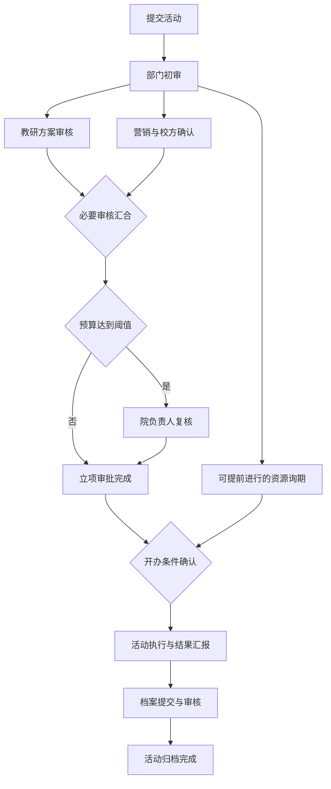

# 服务端流程与节点审批流转设计

日期：2026-10-21 · 对应动态配置 V0.3

> 实施更新：正式 Vue、Node、MySQL 项目已落到本工作区。本文保留为原服务端设计方案；当前实现、接口路径与待确认范围见 [前后端实施说明](前后端实施说明.md) 和 [API接口说明](API接口说明.md)。

## 1. 设计阶段的原型与服务端职责

当前原型是前端模拟，流程解析、资格判断和节点推进分别见 `prototype/config-model.js` 的 `cmResolve`、`cmTaskReady`、`cmCanAct`，以及 `prototype/config.js` 的 `ccActNode`。本文件定义正式服务端实现方案，不代表已存在后端服务。

服务端保存流程实例、节点实例、依赖关系与每位受理人的任务。每次办理结束后检查后继的有效前置，满足条件才激活后继。一张活动可以同时存在多条有效待办。

菜单和页面只提供入口；服务端从登录会话读取真实员工、公司和组织，独立校验表单、权限、数据范围与任务归属。

## 2. 一场活动如何启动

1. 接收活动提交，校验登录身份、提交权限、所属公司、部门、表单 schema、字段可见条件和业务约束。
2. 读取一个已发布配置版本，冻结表单 schema、申请内容、流程定义、条件输入及组织解析上下文。
3. 校验任务图无环、必办环节可到达结束点、必要门槛保留，计算生效分支。
4. 对被跳过的条件节点，保留命中／未命中原因，后继继承原有有效前置。不能把被跳过节点的后继全部直接激活。
5. 解析受理人，保存实际人员快照和解析规则。发现缺人、自审、无办理权限或数据范围不覆盖时阻止提交，不生成半张有效工单。
6. 事务内创建申请版本、流程实例、节点／边快照，节点初始为 WAITING；无未完成有效前置的根节点转 ACTIVE，并创建每位受理人的 PENDING 任务。
7. 同事务写入审计和通知事件；事务提交后投递站内消息及企业平台通知。

## 3. 示例任务图

部门初审通过后，教研、营销和允许提前开展的询期任务可以同时出现。教研单独通过时，汇合节点继续等待营销；两项都通过后再判断预算分支。立项审批完成后，活动还要等待必要筹备条件，执行与归档后才算整场活动完成。

提交时根据申请快照固定预算分支；执行中修改预算需要正式内容变更与重新审批，不能读取某个浏览器里的最新草稿重新选路。

## 4. 一次审核请求如何处理

建议接口：`POST /api/workflow/tasks/{taskId}/decisions`。

请求仅提供 decision（同意／退回／拒绝）、comment、expectedTaskVersion、idempotencyKey。退回可增加 targetNodeAttemptId 或补充责任人。操作者、公司、角色、数据范围、下一节点和受理人由服务端解析。

### 事务内的处理顺序

1. 从会话取得真实身份，找到任务所属实例；按统一顺序先锁定流程实例记录，再取得当前任务与节点，结构调整和办理共用此顺序。
2. 校验公司隔离与实例可访问性；查询幂等记录。相同键与相同请求返回首次结果，键相同而内容不同则报冲突。
3. 检查实例仍在运行、节点 ACTIVE、任务 PENDING、当前任务版本匹配、操作者是受理人、账号及组织有效、操作权限和数据范围有效、禁止自审。检查任务绑定的申请版本仍是本轮有效版本。
4. 条件更新当前任务，记录决定、意见、处理人、处理时间；同一任务只允许从 PENDING 被处理一次。
5. 按节点完成策略归并任务结果。MVP 会签为 ALL：全部受理人同意，节点才完成。同一节点两人办理，第一人的同意只完成个人任务。
6. 节点完成后检查其后继。只有 WAITING 且全部有效必办前置完成的节点才能转 ACTIVE。自动汇合和条件节点在事务内连续计算，直到没有更多自动可推进项。
7. 新激活的人工节点校验冻结受理人的当前资格，再创建唯一待办；人员无效时标记人员异常并等待明确改派，不自动跳过。此时保留刚才已经成功的审核决定。
8. 更新审批阶段汇总与活动阶段，追加审计、幂等结果和 Outbox 事件，提交事务。
9. 提交后投递通知；前端刷新流程图和我的待办。通知失败通过重试处理，办理结果与站内待办已保存。

同一个流程实例的办理和调整串行进入数据库事务，不同活动可以并行处理。实例锁用于保持结构和激活结果一致，不要求在整个活动生命周期持有锁。

## 5. 节点、任务与活动状态分开

| 层级 | 状态举例 | 说明 |
| --- | --- | --- |
| 活动 | 申请、筹备、执行、归档、结束 | 业务进度；可另存审批进度与异常标记 |
| 流程实例 | RUNNING、COMPLETED、REJECTED、CANCELLED | 整个实例生命周期 |
| 节点实例／轮次 | WAITING、ACTIVE、SUSPENDED、COMPLETED、RETURNED、REJECTED、INVALIDATED、SKIPPED | 表示具体业务环节及本轮有效性 |
| 个人任务 | PENDING、APPROVED、COMPLETED、RETURNED、REJECTED、CANCELLED | 表示某个受理人的办理记录 |

节点含两位审核人时，保存两条个人任务。任务实例轮次不同，即使名称与受理人相同，也不是同一条待办。退回后的新轮次生成新任务，旧意见保留。

“当前处理人”应查询所有 ACTIVE 节点上的 PENDING 任务集合，不在活动表里只保存一个 currentUserId。进度列表可以汇总为“教研审核、营销确认并行，2 人待处理”。

## 6. 动态加签与插入如何生效

结构调整接口：`POST /api/workflow/instances/{instanceId}/adjustments`，携带 expectedStructureRevision、调整原因、新增节点及位置。服务端根据已发布规则和允许的调整动作校验，不接受任意跳状态请求。

### 前加签

原来 `A → B`，B 当前正在待办；调整为 `A → X → B`。

- 锁定实例，校验流程调整权限、数据范围、结构版本、B 的当前状态与必要门槛。
- 使 B 当前未办理任务失效，B 转 WAITING，新增 X 并激活。
- 记录调整前后依赖、原因、操作者、失效任务和新结构版本 R+1。
- X 完成后，为 B 创建新的任务轮次；旧链接和旧按钮因任务失效／版本过期被拒绝。
- 如果 B 已有部分会签意见，默认本次加签后开启新轮次，旧票保留且不沿用。若 B 已全部完成，不允许事后前加签，改用正式重审／变更流程。

### 后插入与并行插入

| 调整 | 新关系 | 激活规则 |
| --- | --- | --- |
| B 后新增 X | B → X → C | B 完成后激活 X，X 完成后才激活 C |
| 与 B 并行新增 X | A → B／X → C | B、X 共享前置，C 等待两者完成 |
| 新增非阻塞知会 | 按触发点创建知会任务 | 不加入必办汇合，不替代原审核门槛 |
| 新增子流程 | 子流程内部节点形成独立任务组 | 内部必要节点完成后，父节点完成再唤醒后继 |

结构变化只影响未完成部分，不能原地改写历史审批结果。若原后继已被激活且尚未办理，调整事务需使其当前待办失效、重新等待；后继已经完成时阻止该调整，并提示发起影响范围明确的重审。

## 7. 退回、拒绝、撤回和取消

| 动作 | 服务端行为 |
| --- | --- |
| 退回补充 | 保存退回意见，暂停受影响依赖，创建补充任务；补充后生成新内容版本及所需节点新轮次，旧任务不重置成待办 |
| 重要字段变更 | 预算、时间、服务对象等变化默认重新进行相应立项审批段；明确绑定哪些意见属于哪一版内容 |
| 拒绝立项 | 当前审批实例结束为 REJECTED，未完成审批任务失效；其他筹备任务按活动终止策略关闭并留痕 |
| 撤回 | 申请人满足撤回规则时，取消本轮待办；重新提交新实例／新轮次 |
| 取消申请 | 创建取消审批子流程，冻结执行类动作，保存原阶段；同意则终止相关未完成任务，拒绝则恢复允许的原任务 |
| 知会未完成 | 不阻塞主流程；归档时由策略及归档确认页决定关闭或转后续事项，记录处理方式 |

独立分支能否在退回期间继续，取决于它是否依赖被退回的资料；预算等关键字段变更扩大暂停及重审范围。暂停、恢复与重新审核均进入审计记录。

## 8. 并发、幂等与消息

- 同一任务重复提交：任务版本检查、PENDING 条件更新与幂等键共同防重复。
- 教研与营销同时通过：同一实例内短事务依次提交。第二笔事务读到第一笔完成结果后激活汇合后继，新待办只创建一次。
- 办理与加签同时发生：共用实例锁与一致锁顺序；先完成者决定合法状态，后到者重新校验。
- 并行审批使用各自任务版本。原型使用整单版本，正式服务端避免因另一个独立节点已处理，就把仍有效的本任务判为过期；结构调整接口单独检查结构版本。
- 新待办唯一约束建议为 `(company_id, node_attempt_id, assignee_id)`，业务事件使用唯一 event_id；同一节点轮次只激活一次。
- 幂等记录同时保存请求摘要与最终响应；同一公司、同一操作者、同一键下不能混用不同请求。
- Outbox 与业务变更同事务写入，投递采用可重试模式，通知消费按 event_id 去重。核心节点状态由数据库事务落定，消息仅触发通知或执行有幂等控制的外部任务。
- 定时任务扫描逾期与无合法受理人的任务，提醒与升级不替代审批决定。

## 9. 最小服务端表结构

| 表 | 关键内容 |
| --- | --- |
| activity | 公司、申请人、部门、业务阶段、审批汇总、当前内容版本 |
| form_revision | 不可变 schema、payload、内容版本、提交人、提交时间 |
| workflow_definition_version | 已发布流程定义、条件与受理规则、必要门槛 |
| workflow_instance | 活动、定义版本、结构版本、生命周期、锁定锚点 |
| workflow_node_instance | 节点类型、原定义标识、父子流程关系、条件快照 |
| workflow_node_attempt | 节点当前轮次、申请版本、状态、完成策略、冻结受理人 |
| workflow_edge | 当前结构依赖、生效分支、结构版本 |
| workflow_task | 节点轮次、受理人、任务状态、决定、意见、任务版本 |
| workflow_adjustment | 结构前后版本、受影响节点与任务、新增原因、操作者 |
| workflow_audit | 提交、决策、暂停、恢复、改派、变更的追加记录 |
| idempotency_record | 公司、操作者、幂等键、请求摘要、响应 |
| outbox_event | 通知／外部任务事件、投递状态、重试信息 |

公司组织、成员、角色、权限和配置发布表沿用 V0.3 设计。所有查询带公司隔离与业务数据范围；历史实例中的负责人快照用于追溯，当前账号资格用于授权。

## 10. 接口边界

| 接口 | 用途 |
| --- | --- |
| `POST /api/activities/{id}/submit` | 校验动态表单、冻结内容并启动实例 |
| `GET /api/workflow/tasks?scope=mine` | 查询本人有效待办 |
| `GET /api/workflow/instances/{id}` | 获取实际任务图、状态、当前可执行动作 |
| `POST /api/workflow/tasks/{id}/decisions` | 同意、退回、拒绝，事务推进 |
| `POST /api/workflow/instances/{id}/adjustments` | 前加签、后插入、并行任务与子流程调整 |
| `POST /api/workflow/tasks/{id}/reassignments` | 对明确的异常或授权场景改派，记录原人和原因 |
| `POST /api/activities/{id}/changes` | 已提交内容的版本化变更与重审 |
| `POST /api/activities/{id}/cancel-requests` | 发起取消子流程 |

轻量部署可以先采用一个应用服务内的活动、配置、权限、流程四个模块，使用一套关系数据库与后台通知任务。数据结构和业务事务先明确，后续再按实际规模决定是否拆分服务或接入现成流程引擎。
