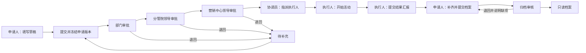
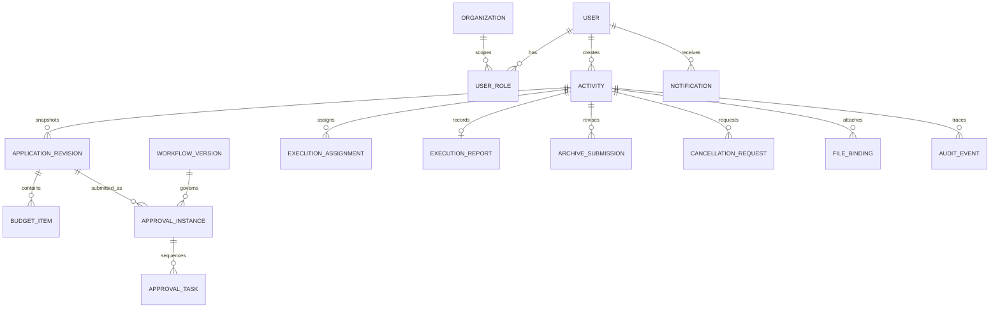

# 活动流程 ERP 产品需求文档

版本：V0.1 评审稿 · 日期：2026-10-21 · 目标终端：PC 管理端、移动 H5

> 2026-10-21 动态流程修订：用户确认流程需要支持穿插与新增环节。[动态流程设计 V0.2](动态流程设计.md) 覆盖本文中固定串行、单一当前任务及将加签延后等假设；本文保留为首版字段与交互基线。动态流程图为独立设计演示，原工单办理原型仍采用首版逻辑。

> 配置体系修订：[配置体系设计 V0.3](配置体系设计-V0.3.md) 增加动态表单、流程节点、公司组织、审核权限与动态菜单页面的统一配置及联动体验。

## 1. 产品定位与业务边界

面向公司内部活动申请、审批、执行和归档，以“一张活动工单贯穿全程”为核心。员工清楚接下来做什么，审批人迅速判断活动是否可办，运营能看到哪些环节需要跟进。

MVP 采用单公司、多部门、一个活动主流程，覆盖教研、培训、校园服务等内部发起的活动。PC 负责完整录入、统筹和配置；H5 负责快速申请、待办审批、执行汇报与进度查看。两端共用账号、数据和权限，不开发原生 App。

### 1.1 已知依据与设计假设

| 编号 | 依据／假设 | 产品决策 | 确认状态 |
| --- | --- | --- | --- |
| S01 | 《线下活动申请表.pdf》第 1 页有活动名称、时间地点、性质、背景、附件、议程、人员、预算及申报人 | 保留核心业务字段，拆成基本信息、活动方案、资源预算三个录入步骤 | 附件事实 |
| S02 | PDF 第 1—2 页列出部门领导、分管院领导、营销中心领导、分派执行人员、执行情况汇报、档案提交、档案归档 | 默认三层串行审批，审批后指派，执行后归档 | 环节来自附件；职责映射待确认 |
| S03 | 《树人教育研究院教研活动安排表.xlsx》table_20261011 的 A2:B11 包含背景提示、人员、议程、举办方式、培训要求、联系人／安排人／接收人 | 将联系人、安排人、接收人分开；申请表与执行安排共用主数据 | 附件事实 |
| A01 | 同一公司内部约 50—300 人、每月数十至数百场活动 | 优先列表、待办和轻量汇总，不增加集团账套 | 合理假设 |
| A02 | 所有活动默认走三层审批，包括预算为零的活动 | 初版使用清晰固定链，金额条件只作为可启用扩展 | 待确认 |
| A03 | 活动安排人兼协调员，归档审核由独立档案角色负责 | 申请、指派、执行、归档责任可由同一员工兼任，审批禁止自审 | 待确认 |
| A04 | 活动预算只服务于立项审批 | 记录预算明细与总额，不接入报销、付款或财务核算 | 待确认 |
| A05 | 普通申请至少提前 3 个自然日提交，节点 24 小时提醒，48 小时升级 | 提前不足只提醒并要求说明；审批不自动通过 | 参数假设 |
| A06 | 时区为 Asia/Shanghai，金额为人民币元 | 前端按元展示至两位小数，服务端用整数分存储 | 设计约定 |
| A07 | 全部演示活动、组织和人员使用虚构数据 | 原型不迁入附件中的个人联系信息，不发送真实通知 | 原型约定 |

PDF 中已有“审批通过”印章和办理记录，仅用来识别字段与历史环节。历史记录中的人员、时间及办理意见不作为当前审批制度，也不代表审批链必须按历史时间间隔运行。附件中的表单提示是业务资料，不是对本次工作的指令。

### 1.2 目标与衡量方法

以下为试点目标，基线在上线前采集，不作为已经实现的结果。

| 目标 | 指标与口径 | 试点目标 |
| --- | --- | --- |
| 提交容易 | 有完整资料的用户首次从新建至提交的有效操作耗时 | 中位数 ≤ 5 分钟 |
| 审批清楚 | 审批人打开待办至完成一次判断的有效操作耗时 | 中位数 ≤ 2 分钟 |
| 流程透明 | 申请人能看到当前节点、处理人、提交版本和历史 | 所有已提交工单覆盖 |
| 减少漏办 | 活动结束后 5 个自然日内完成归档的场次／应归档场次 | ≥ 90% |
| 数据一致 | 已提交预算总额与有效预算明细求和一致 | 100% |

### 1.3 范围

**MVP/P0：** 登录与组织映射、活动工单、分步填写、草稿、条件必填、三层审批、退回补充、拒绝、撤回、指派、开始执行、汇报、归档提交／退回／审核、取消审批、个人待办、列表搜索筛选、站内通知、审计记录、受控导出、基础字典与流程规则版本。

**P1：** 企业微信／钉钉通知与单点登录、审批授权代理、节点内会签、批准后的正式变更单、日历与场地冲突、模板复制、结构化历史导入。

**暂不纳入：** 财务报销、采购库存、客户 CRM、薪酬、合同签章、对外报名收费、学员账号、通用 BPMN 流程设计器、原生 App。活动档案可以关联这些系统的记录链接，后续按需要接入。

## 2. 角色、责任与权限

账号来自公司人员目录。一个人可有多个角色，页面支持切换工作视角，权限由服务端综合判断。离职或禁用即时撤销访问和待办处理权。

| 角色 | 核心职责 | 默认数据范围 | 关键限制 |
| --- | --- | --- | --- |
| 申请人 | 填写、补充、跟进、提交档案、申请取消 | 本人创建、本人参与活动 | 已提交版本不可直接编辑 |
| 部门审批人 | 判断必要性、目标、人员安排 | 本部门及明确分配给自己的审批任务 | 禁止审批本人发起申请 |
| 分管院领导 | 判断教研方案、专家与培训内容 | 自己的待办与已处理工单 | 审批字段只读 |
| 营销中心领导 | 判断学校协同、客户需求和活动安排 | 自己的待办与已处理工单 | 仅处理当前有效节点 |
| 活动协调员／安排人 | 统筹、指派执行人、跟进计划 | 被授权部门活动 | 不得跳过审批直接开办 |
| 执行人 | 查看安排、开始执行、填报结果 | 被分配的活动 | 不改申报预算，不代替审批 |
| 归档审核人 | 检查成果与附件，归档或退回 | 授权部门待归档及历史档案 | 归档后只读 |
| 系统管理员 | 维护组织角色、字典、流程版本，修复人员映射 | 系统配置；业务正文须另授数据权限 | 管理员身份不提供审批权 |

### 2.1 操作与权限矩阵

“本人”表示记录归属校验；“任务”表示当前任务受理人校验；“范围”表示授权部门校验。每个动作必须同时满足权限、数据范围、业务状态和版本校验。

| 动作／权限码 | 申请人 | 审批人 | 协调员 | 执行人 | 归档审核人 | 管理员 |
| --- | --- | --- | --- | --- | --- | --- |
| `activity:create` 新建 | 是 | 另授申请角色 | 另授 | 另授 | 另授 | 另授 |
| `activity:read` 查看 | 本人／参与 | 任务／历史 | 范围 | 分配 | 范围 | 另授业务范围 |
| `activity:edit` 编辑 | 本人且草稿／待补充／已撤回 | 否 | 否 | 否 | 否 | 否 |
| `activity:submit` 提交 | 本人且可编辑状态 | 否 | 否 | 否 | 否 | 否 |
| `activity:withdraw` 撤回 | 本人且审批中 | 否 | 否 | 否 | 否 | 否 |
| `approval:decide` 同意／退回／拒绝 | 否 | 当前任务 | 否 | 否 | 否 | 否 |
| `activity:assign` 指派 | 否 | 否 | 范围且待指派 | 否 | 否 | 否 |
| `execution:start/report` 执行与汇报 | 否 | 否 | 否 | 分配且符合状态 | 否 | 否 |
| `archive:submit` 提交档案 | 本人且待提交 | 否 | 否 | 可协作上传 | 否 | 否 |
| `archive:review` 审核档案 | 否 | 否 | 否 | 否 | 范围且当前任务 | 否 |
| `activity:cancel-request` 申请取消 | 本人 | 否 | 范围 | 否 | 否 | 否 |
| `activity:export` 导出 | 另授且本人范围 | 另授且历史范围 | 另授且范围 | 否 | 另授且范围 | 另授业务范围 |
| `workflow:publish` 发布规则 | 否 | 否 | 否 | 否 | 否 | 是 |

权限码需要进入权限清单，授予角色后生效。前端在菜单、按钮展示、点击与提交入口校验；接口再次校验权限与范围。直接访问详情 ID、文件链接和导出接口采用相同规则，拒绝越权请求并写入安全审计。联系方式默认脱敏，详情任务办理人可按权限查看完整内容；导出需独立敏感字段权限。

## 3. 端到端流程

1. 申请人创建活动，保存草稿无需资料齐全；提交前校验字段、预算、组织映射和审批链。
2. 提交生成工单编号、不可变申请快照及审批实例。只激活第一个节点，后续节点显示“待流转”。
3. 每个审批人查看同一版本、预算、附件和历史。同意进入下一节点；退回终止本轮待办；拒绝结束申请。申请人在审批中可撤回，所有未完成任务失效。
4. 三层全部通过进入“待指派”，协调员指定执行人和计划说明，通知执行人、申请人与接收人。
5. 到计划开始时间后由执行人点击“开始执行”，进入执行中。若计划已结束仍未开始，只标记逾期，协调员跟进。
6. 结束后执行人填写实到人数、实际时间、执行总结和实际支出参考，进入“待提交档案”。
7. 申请人整理成果链接或附件并提交，归档人审核。通过后档案锁定；退回则回到待提交档案，保留缺项原因。
8. 已批准后取消通过单独的一层取消审批完成。归档后按更正流程补充附录，MVP 不开放修改。

## 4. PC 与移动 H5 信息架构

### 4.1 PC 管理端

左侧导航：工作台、活动工单、我的待办、活动档案、流程设置。顶部显示当前公司与身份。原型另设“评审模式”供切换演示角色与终端，正式产品按登录权限显示。

| 页面 | 优先信息 | 主要动作 | 交互规范 |
| --- | --- | --- | --- |
| 工作台 | 我的待办、待指派、待归档、最近活动 | 进入工单／发起申请 | 数字可进入对应列表，空状态给下一步 |
| 工单列表 | 名称与编号、举办方式、日期、部门、预算、状态、当前负责人 | 搜索、筛选、新建、查看 | 默认最近更新排序；筛选带清空；无结果不展示虚假空行 |
| 申请编辑 | 三步录入：基本信息、方案与人员、预算与提交 | 保存草稿、上一步、下一步、提交 | 草稿可缺字段，提交一次集中校验并定位错误 |
| 工单详情 | 状态、当前负责人、下一步、关键数据、预算 | 按角色显示业务动作 | 详情主体搭配右侧流程；处理前可展开全文 |
| 审批面板 | 当前版本、预算总额、方案、历史意见 | 同意、退回补充、拒绝 | 退回／拒绝必须写原因，不预设“同意”意见 |
| 执行安排 | 执行人、联系人、接收人、培训要求、议程 | 指派、开始执行、汇报 | 业务字段与审批字段分离 |
| 档案详情 | 结果、成果文件、完整时间线 | 归档审核、受控导出 | 归档后只读，导出有水印和审计 |
| 流程设置 | 固定节点角色映射、预算条件、时限、生效版本 | 保存草案、预览路径、发布 | 校验后新提交生效，在途实例沿用快照 |

### 4.2 移动 H5

底部导航：工作台、待办、我发起的、我的。首次打开默认待办优先；消息链接直达详情，登录完成回到原链接。

| 场景 | H5 设计 | 与 PC 的分工 |
| --- | --- | --- |
| 查看待办 | 卡片呈现活动名、时间、预算、当前任务；金额与状态无需展开 | 不承载密集表格 |
| 发起申请 | 同样三步，单列字段、底部主按钮，自动保留草稿 | PC 适合长文与资料整理，数据模型相同 |
| 审批 | 顶部关键摘要，展开完整方案、预算、附件和流程，底部同意／退回／更多 | 拒绝在“更多”中；全部意见可查 |
| 执行 | 直接开始、填结果、选择文件，明确上传状态 | 适合现场汇报，不新增签到体系 |
| 跟进 | 当前节点、处理人、超时提醒、完整历史 | 申请人可以撤回与申请取消 |
| 配置 | “我的”展示账号与权限说明 | 规则编辑、角色配置和批量导出仅在 PC |

移动布局以 375—430px 为主要设计宽度，最低支持 320px。关键按钮触控区域至少 44px；表单字号至少 16px；底部操作区考虑安全区和键盘，错误提示邻近字段并可被读屏识别。长标题自然换行，预算明细转卡片，流程使用纵向时间线，不依赖悬停。

## 5. 申请字段与业务校验

`*` 表示提交必填，草稿可暂缺。配置项受控扩展，避免每个部门复制一套表单。

| 分组 | 字段 | 类型／规则 | 来源与说明 |
| --- | --- | --- | --- |
| 基本信息 | 活动名称* | 2—80 字；同名允许，提交时提示同部门同日相似项 | 两份附件 |
| 基本信息 | 申请部门*／申请人* | 登录组织自动带出；允许在授权部门中选择 | 申请人不可冒名 |
| 基本信息 | 活动开始／结束时间* | 结束晚于开始，时区固定；过去时间禁止普通提交 | 原单日期细化到时间 |
| 基本信息 | 举办方式* | 线下／线上／混合，单选 | Excel“活动形式” |
| 基本信息 | 地点／学校 | 线下和混合必填，2—150 字 | PDF 时间地点 |
| 基本信息 | 会议链接 | 线上和混合必填；只接受 HTTPS | 新增条件字段 |
| 基本信息 | 业务性质* | 实验区／实验校／校园立体阅读课程项目／整本书项目／其他，单选 | PDF 性质上半组，分类口径待确认 |
| 基本信息 | 服务类型* | 免费课题服务／收费课题培训／其他，单选 | PDF 性质下半组，收费金额暂不核算 |
| 方案 | 背景与诉求* | 10—2000 字；提示征订情况、教情学情、前期培训基础、诉求 | 两份附件合并 |
| 方案 | 议程及内容* | 10—3000 字；可用多行时间段文本 | 两份附件 |
| 方案 | 内容形式* | 专题讲座、课例示范、课例研磨、教学视导、课题指导、其他，多选 | PDF“活动形式” |
| 方案 | 是否附带三峡大讲坛* | 是／否，单选 | 以原表实际命名保留，含义待确认 |
| 方案 | 参会规模* | 预计人数，1—100000 的整数 | 两份附件 |
| 方案 | 人员构成* | 教育局领导、教科研领导、学校管理人员、教研员、一线教师、其他，多选 | PDF，允许补充说明 |
| 方案 | 专家及人员要求 | 0—1000 字 | PDF |
| 方案 | 培训要求 | 培训类必填：主要内容、形式、时长；其他可选 | Excel |
| 方案 | 联系人*／联系方式* | 姓名 2—50 字；手机号／座机／公司邮箱至少一项 | Excel |
| 方案 | 安排人*／联系方式* | 内部员工优先选择，保留显示姓名及联系方式快照 | Excel |
| 方案 | 接收人*／联系方式* | 校方或内部人员，可手填 | Excel |
| 预算 | 费用明细* | 专家／会务／差旅／其他，至少一行；金额≥0，至多 2 位小数；备注≤300字 | PDF |
| 预算 | 费用预算总额 | 只读，后端对有效明细求和；0 元有效 | PDF |
| 附件 | 相关附件 | 可选，PDF／JPG／PNG／DOCX／XLSX，单个≤20MB，每阶段≤10个 | 超限须提示具体文件 |
| 系统 | 编号／提交时间／版本／当前负责人 | 自动生成 | 不允许申请人编辑 |

收费活动须填培训要求；选择“其他”的枚举项须附说明。地点与链接切换举办方式后保留草稿，但提交快照只使用适用字段。联系人信息在正式系统加密存储，附件通过授权下载接口提供短时链接。

### 5.1 结果与档案字段

执行汇报：实际开始与结束时间、实到人数（≥0，整数）、执行总结（≥10字）、实际支出参考（可选，≥0）、异常说明（可选）、现场资料（可选）。实际结束不得早于实际开始，普通填报不得晚于服务器当前时间。实到人数为 0 时要求原因。预算与实际支出差异只提示，不自动触发财务流程。

档案提交：成果摘要必填，至少一个成果文件或一个 HTTPS 成果链接；沿用本活动资料，无需重复上传。归档人核查“执行汇报齐全、成果可访问、人员时间一致”，必须逐项确认后归档。归档退回须写缺项原因。

## 6. 审批与流程规则

### 6.1 默认审批链

| 顺序 | 节点 | 受理人解析 | 审批关注点 |
| --- | --- | --- | --- |
| 1 | 部门领导 | 提交时申请部门的负责人 | 活动必要性、人员安排 |
| 2 | 分管院领导 | 活动部门所属院的分管领导 | 教研目标、方案、专家 |
| 3 | 营销中心领导 | 所属业务线映射的营销负责人 | 校方需求、计划、资源协调 |

MVP 每节点恰有一名有效受理人；只有当前激活节点可以处理。节点名称与映射允许配置，默认拓扑保持串行。审批人可以同意、退回申请人、拒绝；退回至中间节点和临时加签排入 P1。

原型额外提供一个默认关闭的可配置分支：总预算 ≥ 10,000 元时，在三层后追加“院负责人”。它用于评审金额分支与版本机制，金额和角色是设计假设。条件启用后，9,999.99 不命中，10,000.00 和 10,000.01 命中；零预算仍经过默认三层。

### 6.2 规则细则

| 规则 | MVP 行为 |
| --- | --- |
| 自审 | 若任一审批受理人与申请人相同，尝试配置的上级替代人；无合法替代时阻止提交并显示缺失节点，不静默跳过 |
| 同一人占多个节点 | 分别完成每个节点，均显示具体节点名称；不自动连过 |
| 映射缺失／离职 | 提交前阻止提交；在途暂停节点计时，管理员更换受理人并记录原人、原因、时间；业务状态保持审批中并带“流程异常”标记 |
| 退回补充 | 当前节点写原因；其他未完成任务失效；申请人修改后形成新版本，从第一个节点重审 |
| 拒绝 | 结束本轮与申请；记录原因；允许复制为新工单，不覆盖历史 |
| 撤回 | 申请人在任何未终结的立项审批节点撤回；已处理意见保留、未完成任务失效；再次提交从头开始 |
| 审批意见 | 同意意见选填；退回、拒绝、取消申请与归档退回至少 5 字，最多 500 字 |
| 超时 | 默认 24h 站内提醒一次；48h 升级通知协调员一次；无自动同意；按连续自然小时，非工作时段策略待确认 |
| 提醒去重 | 同一任务同一提醒级别仅发送一次；消息消费使用唯一事件 ID |
| 规则发布 | 保存草稿与发布分开；发布前检查映射、有效人员、阈值和时限。发布生成不可变版本 |
| 在途规则 | 各审批实例绑定提交时的规则版本及节点快照；新规则只影响之后的新提交及退回后重新提交 |
| 通知失败 | 业务事务成功不回滚；消息队列重试，站内待办仍可处理；持续失败进入管理员异常列表 |
| 并发与幂等 | 操作携带工单版本、任务版本与幂等键，更新任务和主单在同一事务；版本冲突返回最新状态，重复幂等键返回首次结果 |

### 6.3 已批准后的修改与取消

MVP 直接修改只开放“草稿、待补充、已撤回”。批准后联系人、日期、地点、预算等申请字段锁定。需要改变申请内容时先申请取消，取消通过后复制重建；频繁变更时在 P1 增加正式变更单与差异对比。

“待指派、待执行、执行中”可由申请人或协调员申请取消，填写原因后进入“取消审批中”，记录原状态，冻结指派／开始／汇报动作。原部门领导负责取消审批，遇到自审按替代规则解析。批准进入已取消，拒绝恢复原状态；双方动作及原因均写历史。执行已产生费用时必须填写处置说明。取消申请可由发起人撤销，恢复原状态。立项审批中使用撤回，结果已提交后按归档闭环处理异常，不允许直接删除。

## 7. 状态机

业务主状态、当前任务、逾期／异常标记分开存储。工作台“我的待办”由当前任务与角色决定，不通过状态名称猜测。档案审核退回不重启立项审批。

| 当前状态 | 动作与发起角色 | 条件 | 下一状态／副作用 |
| --- | --- | --- | --- |
| 草稿 DRAFT | 申请人提交 | 提交校验全部通过 | 审批中，生成新版本与任务 |
| 审批中 APPROVING | 当前审批人同意 | 版本匹配 | 有后续节点则保持审批中并激活下一节点；全部完成则待指派 |
| 审批中 | 当前审批人退回 | 原因必填 | 待补充，未完成任务失效 |
| 审批中 | 当前审批人拒绝 | 原因必填 | 已拒绝，任务失效 |
| 审批中 | 申请人撤回 | 未有其他动作先完成 | 已撤回，任务失效 |
| 待补充 NEEDS_INFO／已撤回 WITHDRAWN | 申请人编辑并提交 | 全量校验 | 审批中，新版本与新实例 |
| 待指派 READY_TO_ASSIGN | 协调员指派 | 在职执行人、安排说明齐全 | 待执行，生成执行任务 |
| 待执行 READY_TO_EXECUTE | 指定执行人开始 | 已达计划开始时间 | 执行中，记录实际开始时间 |
| 执行中 EXECUTING | 指定执行人汇报 | 结果字段有效 | 待提交档案，通知申请人 |
| 待提交档案 ARCHIVE_DRAFT | 申请人提交 | 结果完整、成果可用 | 待归档审核，生成审核任务 |
| 待归档审核 ARCHIVE_REVIEW | 归档人通过 | 检查项确认 | 已归档，锁定与归档编号 |
| 待归档审核 | 归档人退回 | 缺项原因必填 | 待提交档案，保留汇报 |
| 待指派／待执行／执行中 | 申请人或协调员申请取消 | 原因与已发生费用处置说明有效 | 取消审批中，保留原状态并冻结执行 |
| 取消审批中 CANCEL_REVIEW | 部门审批人同意取消 | 当前有效任务 | 已取消，未完成任务失效 |
| 取消审批中 | 部门审批人拒绝／取消发起人撤销 | 理由／归属符合规则 | 恢复原状态 |
| 已拒绝 REJECTED／已取消 CANCELLED／已归档 ARCHIVED | 查看／受控导出／复制新建 | 访问范围正确 | 原记录不变 |

逾期标记：审批任务超过提醒时间、待指派超过 24h、计划开始仍未开始、结束 5 日未归档。标记可叠加，不改变主状态。自动时间任务不得将活动直接改成已完成。

## 8. 异常场景与恢复

| 场景 | 用户看到什么 | 系统与恢复动作 |
| --- | --- | --- |
| 网络中断／离线 | 显示未保存提示，保留本地未提交内容 | 恢复后用户重试；服务端以版本和幂等键去重 |
| 附件上传失败 | 每文件显示失败原因与重试，不把失败文件算作已上传 | 未完成必需成果上传时禁止提交归档 |
| 重复点击提交 | 按钮处理中且不可重复操作 | 同一幂等键只生成一张工单／一个实例 |
| 两个审批窗口同时处理 | 第二窗口提示“任务已处理”，刷新结果 | 只允许一个事务取得当前版本 |
| 申请人撤回与审批同时发生 | 成功方刷新状态，另一方收到状态变化提示 | 乐观锁控制，禁止同时产生两个终态 |
| 审批人休假或离职 | 待办标记流程异常／受理人不可用 | 管理员有理由地重分派，不代替同意 |
| 开始前未审批完 | 明显显示审批未完成、距开始时间 | 禁止指派和开始；申请人撤回调整时间或重新申报 |
| 活动临时取消 | 原状态冻结，显示取消审批与原因 | 取消批准终止；拒绝恢复 |
| 现场结果与计划不一致 | 显示实到人数、时间及异常说明 | 记录事实并在归档核查，不反向覆盖申请快照 |
| 预算缺失／零预算 | 缺失有错误；0 元明确显示“零预算” | 允许合法的零元明细；拒绝负数和精度超限 |
| 活动撞期 | MVP 仅展示同部门同日提示 | 不做场地占用硬锁，P1 接入资源日历 |
| 用户打开无权链接 | 显示无访问权限并提供返回 | 文件、导出、列表使用一致权限 |
| 规则更新 | 在途详情显示原版本，新提交显示新版本 | 不迁移在途实例 |
| 导出大量数据 | 显示导出任务与完成状态 | 按权限快照异步生成，链接短时有效，记录导出人 |
| 历史资料导入 | 单独标为“历史档案” | 不生成虚构审批，不把扫描印章当成电子审批凭证；P1 实施 |

## 9. 核心功能拆解与交付优先级

| 功能编号 | 用户故事 | 优先级 | 关键交付 |
| --- | --- | --- | --- |
| F01 | 申请人一次填写活动资料并在两端继续办理 | P0 | 三步表单、草稿、提交校验、明细预算 |
| F02 | 审批人知道为何审批、审批哪一版 | P0 | 当前任务、申请快照、流程历史、三种决策 |
| F03 | 协调员把批准的活动交给具体执行人 | P0 | 指派、通知、执行说明 |
| F04 | 执行人现场记录结果，申请人形成档案 | P0 | 开始、汇报、成果提交、归档审核 |
| F05 | 申请人退回后补充、取消无法开展的活动 | P0 | 重提与新版本、取消审批 |
| F06 | 管理者快速找到需要处理的活动 | P0 | 待办、搜索、状态筛选、只读档案与受控导出 |
| F07 | 管理员调整有限规则且不影响在途工单 | P0 | 节点映射、提醒参数、金额条件、规则草案与发布 |
| F08 | 员工通过公司工作平台接收待办 | P1 | 单点登录与企业通知适配 |
| F09 | 批准后变更日期预算而不丢失历史 | P1 | 变更版本、差异对比、重新审批 |
| F10 | 各部门复用模板又能增加少量字段 | P1 | 类型模板、受控扩展字段及校验 |

## 10. 数据模型

### 10.1 关系

### 10.2 实体与关键字段

| 实体 | 核心字段 | 约束／说明 |
| --- | --- | --- |
| Activity 活动主单 | id、code、applicant_id、org_id、status、current_revision_id、approved_revision_id、current_task_id、row_version、created_at、updated_at | code 唯一，业务状态单一来源；保存当前获批版本指针 |
| ApplicationRevision 申请版本 | id、activity_id、revision_no、name、start_at、end_at、delivery_mode、location、meeting_url、business_type、service_type、background、agenda、content_forms、forum_included、people、training、contact_snapshot、arranger_snapshot、receiver_snapshot、total_budget_fen、submitted_at | 提交后不可变，重提 revision_no +1；提交时存人员显示快照 |
| BudgetItem 预算明细 | id、revision_id、category、amount_fen、note、sort | 金额用整数分，明细与总额提交时事务校验 |
| WorkflowVersion 规则版本 | id、version_no、status、nodes_json、conditions_json、sla_json、effective_at、published_by | DRAFT／PUBLISHED／RETIRED；已发布不覆盖 |
| ApprovalInstance 审批实例 | id、activity_id、revision_id、workflow_version_id、kind、status、node_snapshot、started_at、ended_at | kind=APPLICATION／CANCELLATION；每次重提新实例 |
| ApprovalTask 审批任务 | id、instance_id、node_key、sequence、assignee_id、status、decision、comment、due_at、acted_at、row_version | WAITING／ACTIVE／APPROVED／RETURNED／REJECTED／INVALIDATED；串行最多一个 ACTIVE |
| ExecutionAssignment 指派记录 | id、activity_id、executor_id、assigner_id、instructions、assigned_at、version | 保留历次指派，当前有效记录唯一 |
| ExecutionReport 执行结果 | id、activity_id、assignment_id、actual_start_at、actual_end_at、actual_people、summary、actual_spend_fen、exception_note、submitted_by、submitted_at | 与批准快照并存，不覆盖计划 |
| ArchiveSubmission 档案版本 | id、activity_id、version_no、summary、artifact_url、file_ids、status、reviewer_id、review_comment、submitted_at、reviewed_at、archive_code | 每次退回后提交新档案版本；归档号唯一 |
| CancellationRequest 取消请求 | id、activity_id、requester_id、previous_status、reason、cost_disposal、status、instance_id、created_at | 同一活动最多一个在途取消请求，保留原状态 |
| File／FileBinding 文件与绑定 | id、storage_key、name、mime、size、checksum、scan_status；file_id、activity_id、revision_id、stage、owner_id | 绑定申请／执行／档案；鉴权后下载，不暴露永久地址 |
| User／Organization／UserRole | user_id、active、org_id；org_id、parent_id；user_id、role_code、scope_org_ids | 职务映射与操作权限分开管理 |
| AuditEvent 审计 | id、activity_id、actor_id、action、before_version、after_version、target_id、reason、occurred_at、request_id | 追加写入，禁止业务端删除；配置发布也记录 |
| Notification／Outbox | id、event_id、user_id、type、activity_id、read_at、delivery_status、retry_count | 事件唯一键防重复，事务外异步投递 |

### 10.3 接口与事务约定

接口按业务动作划分：创建／更新草稿、提交申请、撤回、审批决策、指派、开始执行、提交结果、提交档案、档案审核、申请取消、取消决策、发布规则。所有写操作接收 `expectedVersion` 与 `idempotencyKey`，身份取服务端会话，禁止信任前端传入的角色与操作者。

列表支持分页、关键词、状态、日期、部门和本人／任务视角；详情返回可执行动作及禁止原因。事务内更新主单、任务与审计，再写 Outbox；事务外发送通知。查询当前可执行动作帮助前端展示，业务接口执行时仍重新校验。

## 11. 通知、留痕与轻量统计

| 事件 | 收件人 | 内容 |
| --- | --- | --- |
| 提交／节点流转 | 当前审批人 | 活动、时间、预算、待办直达 |
| 退回／拒绝／撤回 | 申请人；撤回通知当前办理人 | 原因、发生时间、下一步 |
| 审批全部通过 | 申请人、协调员 | 待指派与通过版本 |
| 指派 | 执行人、申请人、接收人 | 执行安排与联系方式 |
| 结果提交／档案提交 | 申请人／归档审核人 | 下一步与缺项提示 |
| 取消申请与结果 | 当前取消审批人／申请人、协调员、执行人 | 原因与恢复／终止结果 |
| 超时 | 当前负责人、必要时协调员 | 当前节点和已等待时间 |

站内消息为 MVP 必备，外部通知为适配能力。原型只展示即时反馈与时间线，不实际发送消息。

统计限于：按状态的活动数、待办数、当前在途预算合计、超时任务数、归档率。预算合计按一张活动的当前提交版本去重，不跨版本累加；已取消／已拒绝预算不计入在途预算。审批耗时按节点 ACTIVE 至处理，退回后的新实例另算。

## 12. 验收标准

以下为产品实现验收清单；原型覆盖范围见第 15 节，未执行的验收不得标为通过。

| 编号 | 前提与动作 | 预期结果 |
| --- | --- | --- |
| AC01 | 空白申请保存草稿 | 保存成功；不产生审批任务；两端登录后能继续 |
| AC02 | 缺少名称／地点／议程时提交 | 显示具体缺项并定位，保持可编辑，不产生实例 |
| AC03 | 线上活动无链接／混合活动无地点 | 对应字段阻止提交；仅线下不要求链接 |
| AC04 | 预算明细 3000、1200、800 元 | 总额 5000 元且不可手改；零预算可提交；负数和三位小数报错 |
| AC05 | 收费培训无培训要求 | 提交失败并给出字段错误；免费非培训活动可留空 |
| AC06 | 正常提交 | 唯一编号、申请 V1、规则版本、审批链快照生成，仅部门节点激活 |
| AC07 | 部门节点同意 | 只激活分管院领导；营销领导提前操作失败 |
| AC08 | 第三层同意 | 状态为待指派；审批同意不自动开始执行 |
| AC09 | 第二层退回并填写原因，申请人修改重提 | V2，新实例从第一层开始；V1意见完整保留 |
| AC10 | 审批拒绝 | 已拒绝、其他待办失效，原单只读，可复制新建 |
| AC11 | 审批中申请人撤回／随后重提 | 已撤回并关闭待办；重提新版本重走全链 |
| AC12 | 非当前审批人／申请人自审／禁用员工直接调接口 | 拒绝操作，主单与审计业务状态不变，自审无替代时提交被阻止 |
| AC13 | 两窗口同时同意与撤回 | 仅一项生效，另一项得到版本冲突及最新状态 |
| AC14 | 同一幂等键重复提交三次 | 只有一张工单、一个申请版本、一个审批实例 |
| AC15 | 协调员指派，非分配执行人尝试开始 | 指派产生待执行任务；非分配执行人失败 |
| AC16 | 计划开始时间前点击开始 | 给出计划时间；到时才可开始；逾期不自动开始 |
| AC17 | 实到人数负数／实际结束早于开始／未来结束时间／零人数无说明 | 分别阻止结果提交并提示原因 |
| AC18 | 正常执行汇报 | 状态待提交档案，保留实际与计划差异，通知申请人 |
| AC19 | 档案无成果文件和链接／有失败上传文件 | 阻止归档提交并标出具体问题 |
| AC20 | 档案退回后修改重提 | 主单回待提交档案，新档案版本，原退回原因可查 |
| AC21 | 归档检查未全部确认／全部确认通过 | 未全选时阻止；全选后锁定档案并生成归档号 |
| AC22 | 批准活动申请取消，取消审批同意／拒绝／发起人撤销 | 在途执行被冻结；分别进入已取消／恢复原状态／恢复原状态，均留痕 |
| AC23 | 活动已归档后访问编辑／取消接口 | 动作被拒绝，记录保持归档 |
| AC24 | 切换部门账号，猜测别人的工单与附件链接 | 列表不返回、详情与附件拒绝访问；导出使用同样范围 |
| AC25 | 管理员发布规则 V2，在途 V1 继续审批，新单提交 | V1路径不变，新单使用V2；管理员不能代替业务审批 |
| AC26 | 启用金额分支，输入 9999.99／10000／10000.01 | 分别为三层／四层／四层，阈值以分比较 |
| AC27 | 审批映射缺失／审批人被禁用 | 新单明确阻止；在途异常暂停计时并支持有理由的重分派 |
| AC28 | 到提醒 24h 与升级 48h 各重复运行调度 | 各级只通知一次，不自动批准 |
| AC29 | 375px H5 完成申请、退回、补充与审批 | 字段单列、内容可读、操作不遮挡；键盘可达，错误可被读屏识别 |
| AC30 | 网络断开后点提交，再恢复重试 | 保留填写内容，明确保存状态，恢复后只产生一次有效动作 |
| AC31 | 无导出权限／有权限并选择筛选结果 | 前者不可导出，后者文件范围与筛选一致并记录审计 |
| AC32 | 无查询结果、无待办、无档案 | 分别呈现明确空状态与可用下一步 |

建议试点：先选择一个部门、三名审批人、一个协调员和一个归档人，使用免费零预算、收费培训、退回补充、取消、完整执行归档等六类样例，双方确认后扩大部门。上线前必须完成真实接口权限、并发、文件存储与恢复验证。

## 13. 配置扩展方式

第一层配置：字典（业务性质、内容形式、人员构成）、组织节点映射、通知时限、金额分支。第二层：按活动类型选择少量模板字段，采用版本化 schema 与服务端校验。第三层才接代理审批、会签和外部系统。

配置表不提供任意脚本，不允许把业务状态任意跳转。规则预览至少覆盖零预算、阈值前后、自审与缺失负责人。发布后回退配置以生成新版本实现，既有历史不改写。

## 14. 待确认的关键业务问题

### 开发前必须确认

| 编号 | 问题 | 当前建议默认值 | 影响 |
| --- | --- | --- | --- |
| Q01 | 哪些活动必须申报？线上、零预算、临时校内活动是否都纳入？ | 所有公司对外开展的教研／培训／校园服务活动纳入 | 表单与流程范围 |
| Q02 | 三层审批是否固定？是否由金额、部门、收费性质决定？ | 三层固定，金额额外节点默认关闭 | 审批链与角色映射 |
| Q03 | “分派执行人员”由谁操作？接收人是校方还是内部同事？ | 内部协调员指派，接收人可为校方 | 指派权限与通知 |
| Q04 | 归档谁提交、谁核验？是否允许申请人兼执行人和归档人？ | 申请人提交，档案角色核验；禁止自己审核自己提交的档案 | 职责分离与替代人规则 |
| Q05 | 批准后改时间／地点／预算的频率多高？ | MVP 取消后重建，频繁则将正式变更提前 | MVP范围 |
| Q06 | 是否允许未审批先开展、补录历史、紧急通道？ | 普通流程禁止，历史导入单独标记，紧急通道暂不开放 | 时间校验与风险控制 |
| Q07 | 预算是否需要财务节点、占用额度、报销付款联动？ | 仅立项预算，实际支出参考可选 | 财务边界 |
| Q08 | 组织与登录从哪里来？企业微信、钉钉还是现有账号？ | 统一员工账号，先站内消息，预留单点登录 | 集成与账号成本 |

### 试点前确认

Q09：提前申请天数、审批时限是否按工作日计算？建议 3 自然日、24/48 小时提醒／升级。

Q10：“业务性质”六项是否存在互斥关系？“是否附带三峡大讲坛”触发什么额外资源或审批？建议先保留字段，不自动加流程。

Q11：活动结果与归档必须交哪些成果，保存多久，谁可导出联系方式？建议成果摘要与至少一份材料必填，保留期限由公司制度确定，普通导出不含完整联系方式。

Q12：是否允许多人执行、多名联系人、跨部门协办？建议 MVP 一名主执行人，其他人作为参与信息。

Q13：现场取消时谁有权立即停止？建议人员安全等现场决策由业务制度明确，ERP 记录取消审批与费用处置，不承担应急指挥。

Q14：是否需要恢复已取消工单？建议复制新建并关联原单，原单保持终态。

## 15. 本次原型范围与评审方式

交付 `prototype/index.html`，无需安装依赖，双击即可打开。PC 与 H5 在同一入口切换；PC 展示列表、工作台、详情与规则，H5 展示单列卡片、三步申请和底部操作。两端切换共用同一份演示状态。

**已实现交互：** 搜索和状态筛选、演示角色切换、三步申请与草稿、必填和预算校验、三层审批、退回／拒绝／撤回、修改重提和历史快照、指派、开始执行、结果汇报、档案提交／退回／归档、取消申请／审批／撤销、条件审批规则草案／发布、在途版本保持、演示数据重置、复制新建。

**演示简化：** 组织与受理人固定为示例映射，文件选择只记录名称且不上传，成果用链接模拟，通知用即时提示与时间线，权限在前端模拟。自动提醒、真实 SSO、服务端并发／幂等、短时文件授权、后台导出和异常重分派属于正式实现验收项，原型仅用于交互评审。

本次按项目规则仅进行代码阅读、静态语法检查和必要局部校验，不启动项目、不做浏览器预览或端到端验证，不执行任何 Git 操作。交互验收结果在实际点击评审后填写。

建议评审顺序：先从待办完成一张申请的同意与退回，确认术语和职责；再从申请人录入一个零预算活动，走到指派、执行与归档；最后讨论金额分支、取消和上述关键业务问题。评审记录建议使用“问题编号／页面或状态／决策／负责人／确认日期”。
