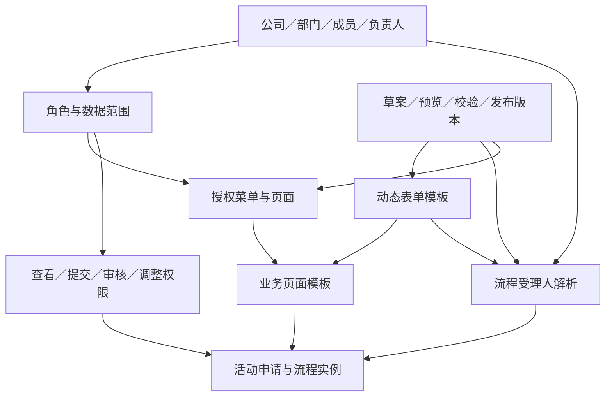

# 活动 ERP 配置体系设计 V0.3

日期：2026-10-21 · 范围：动态表单、动态流程节点、公司组织架构、审核权限、动态菜单页面

## 1. 产品结构

活动业务使用一套共享配置：组织提供部门、人员和负责人；角色绑定菜单页面、操作权限和数据范围；表单定义活动内容；流程引用表单字段和组织规则分配任务；菜单把已授权的业务页面呈现给用户。

PC 新增“配置中心”：配置总览、动态表单、流程节点、组织架构、角色权限、菜单页面、联动体验。移动 H5 展示已授权菜单、运行表单和办理任务；完整配置放在 PC。

## 2. 动态表单

### 配置内容

- 模板：名称、稳定标识、版本、适用业务、状态。
- 字段：稳定键、中文标题、类型、默认值、必填、顺序、选项、校验、可见条件。
- MVP 控件：单行文字、多行文字、数字、下拉选择、日期时间；部门和申请人从账号带入，不由用户伪造。
- 条件：引用其他字段的等于／不等于条件；隐藏字段不参与必填校验，提交快照只收集当前可见字段。
- 节点权限：字段可读、可写、隐藏。MVP 申请阶段可写，审批阶段只读；特定节点的字段级授权作为后续配置扩展。

### 关键规则

字段键发布后保持稳定；标题与布局可以调整。被流程条件或显示条件引用的字段不能直接删除；类型变更须校验引用兼容性。表单中数字零值和空值分开处理。新增模板版本只影响新提交，在途申请保留旧 schema、payload 与展示标签。

本次配置演示以一个活动申请模板说明联动，可增删、编辑、排序字段，配置必填、下拉选项和显示条件，使用当前草案或已发布版本预览。

## 3. 动态流程节点

沿用 V0.2 的依赖图，节点可以串行、并行和按条件生效。配置节点名称、类型、前置依赖、受理规则与可选条件；前插、后插、并行新增通过修改依赖完成。

| 受理方式 | 解析规则 | 异常处理 |
| --- | --- | --- |
| 申请部门负责人 | 读取申请人的有效主部门负责人 | 部门／负责人停用、缺失或自审时阻止提交 |
| 指定员工 | 指定有效成员 | 账户停用／缺少对应办理权限时提示修复 |
| 指定角色 | 在公司有效成员中匹配角色 | 无人时阻止；多人时默认全部办理后完成节点 |

默认例子：部门初审 → 教研审核与营销确认并行 → 预算≥10000元时追加院负责人。金额阈值是设计示例，待业务确认。条件不命中的节点被跳过，后继继承其前置依赖，不能因为跳过节点而丢失前序审核。

审核资格同时满足：账户有效、拥有审核动作权限、属于本任务受理人、前置完成、当前节点有效、禁止自审、版本匹配。拥有“审核”按钮权限不等于可以审核所有活动。

已提交实例保存实际节点、受理人、条件结果和配置版本。配置发布不重排旧任务。离职／停用或撤销审核权限立即停止办理资格，原任务进入人员异常处理，不默认为通过。

## 4. 公司组织架构

结构：公司 → 部门 → 子部门；成员绑定主部门，可扩展兼职部门。部门有负责人、排序和启停状态；成员有姓名、岗位、角色与启停状态。

MVP：树形展示、新增部门、设置负责人、新增员工、分配角色、启停人员。禁止部门移动到自身或子孙节点；含有效成员、下级或在途任务的部门不直接删除，采用停用或迁移。部门负责人必须是该部门有效成员；跨部门分管关系用流程角色处理。

主部门归属与角色是两回事：陈宁属于教研一部，并被授予部门审核角色；周岚可以属于院务部门，同时通过角色审核其他部门活动。

## 5. 权限体系

权限拆成四层，全部由接口执行时再校验：

| 层级 | 控制内容 | 示例 |
| --- | --- | --- |
| 菜单权限 | 是否出现导航入口 | 可见“我的待办” |
| 页面权限 | 是否允许直接进入页面 | 有待办页面访问权才能访问对应页面标识 |
| 操作权限 | 可执行什么动作 | 新建、提交、审核、流程调整、配置管理 |
| 数据范围 | 可以对哪些记录操作 | 本人、本部门、本部门及下级、相关任务、全公司 |

角色可以组合，授权取有效角色的并集，最后叠加业务状态、任务归属、禁止自审和字段策略。未授权默认拒绝。配置管理员默认只有配置权，不附带业务数据读取或审核权。

审核人仍须取得活动读取权限；任务范围包括自己被分配的当前及历史任务。流程负责人可以调整授权范围内未完成的任务图，不能改写已完成意见或绕过必要门槛。

本次演示权限码：`activity:read`、`activity:create`、`activity:submit`、`approval:decide`、`task:complete`、`workflow:adjust`、`config:manage`。正式研发按权限清单注册并授予角色，UI、点击／提交入口、接口与文件下载均执行检查。

## 6. 动态菜单与页面

采用“菜单配置 + 已注册页面模板 + 表单／流程绑定”。菜单配置名称、父级分组、排序、启停、授权角色和目标页面；页面配置稳定标识、页面模板和业务表单绑定。

MVP 页面模板：工作台、活动列表、申请表单、任务列表、档案列表、配置概览。新建菜单页面可以复用模板；不允许上传任意代码或执行配置中的脚本。已有 Vue 自动路由项目正式实现时按约定页面目录注册页面组件，配置菜单只引用已注册页面，不修改自动生成路由。

一个页面需同时满足菜单有效、父菜单有效、角色授权、页面所需操作权限。隐藏菜单不替代页面鉴权；业务接口仍检查真实身份、动作与数据范围。角色移除某页后，已经打开的页面也显示无权限。

H5 先按相同授权规则得到可访问页面，再按移动端优先级排列；配置页面在 PC 编辑。页面模板的表格在 H5 转为卡片，表单转为单列，审批保留底部动作。

## 7. 配置发布与联动体验

配置草案 → 模块内编辑保存 → 全量引用／组织／权限／流程校验 → 预览 → 发布不可变快照。

一次发布生成配置版本 Cn，包含表单、流程、菜单和角色配置快照。正式系统中，人员启停与角色撤销是即时安全变更；表单与流程结构继续采用提交快照。演示采用显式发布配置以观察联动，避免未发布的修改混入运行结果。

联动体验区支持选择草案／已发布版本和演示员工：

1. 根据该员工角色生成菜单。
2. 按数据范围筛选活动记录。
3. 根据页面绑定 schema 生成表单并校验条件字段。
4. 提交时以申请部门和预算等数据解析审核人、条件节点及并行任务。
5. 切换至任务受理人，查看可见数据和可办理节点；没有权限的身份没有审核按钮，动作入口再次校验。
6. 修改并发布表单／流程后，新申请使用新配置；已提交实例保留旧 schema 与流程受理快照，办理资格仍受当前账号和权限约束。

配置体验的数据独立于 V0.1 工单演示与 V0.2 流程图演示。本次用于需求评审，身份切换、配置发布与审核均为本地模拟。

## 8. 核心数据模型

| 实体 | 关键字段 |
| --- | --- |
| Department | id、company_id、parent_id、name、manager_user_id、active、sort |
| Member | id、name、primary_department_id、active、role_ids |
| Role | id、name、permission_codes、data_scope |
| RolePageGrant | role_id、page_id |
| MenuGroup | id、name、active、sort |
| PageDefinition | id、key、name、group_id、component_key、form_template_id、active、sort、required_permission |
| FormTemplateVersion | template_id、version、schema_json、published_at |
| FieldDefinition | id、key、label、type、required、options、visibility、validation、sort |
| WorkflowNodeDefinition | id、kind、label、deps、assignee_rule、condition、completion_policy |
| ConfigurationRelease | id、version、snapshot、published_by、published_at |
| RuntimeActivity | id、org_id、applicant_id、configuration_version、schema_snapshot、payload、node_instances、status、version |
| ConfigurationAudit | id、actor_id、target_type、action、before_version、after_version、reason、created_at |

所有配置写操作携带版本与幂等键，先检查引用再事务提交。账号、组织、角色信息从服务端会话解析；前端传入的身份与部门只作为展示，不能当作授权凭据。

## 9. 验收增量

| 编号 | 场景 | 预期 |
| --- | --- | --- |
| CF01 | 新增必填字段并发布 | 新申请出现字段且必填，旧申请展示原 schema |
| CF02 | 举办方式切换至线上 | 依规则隐藏地点，隐藏字段不报必填、不进入提交 payload |
| CF03 | 删除被条件引用字段 | 阻止并说明引用位置 |
| CF04 | 新增节点或并行分支 | 依赖合法；当前任务计算正确，汇合等待全部有效前置 |
| CF05 | 预算条件不命中 | 跳过条件节点并继承依赖，后继不提前激活 |
| CF06 | 替换部门负责人 | 后续提交使用新负责人，原实例不静默改派 |
| CF07 | 审核人停用／撤销权限 | 无法办理；实例保留原记录并提示人员异常 |
| CF08 | 当前审批人是申请人 | 阻止提交或要求配置替代人，禁止自审 |
| CF09 | 用户只有本人数据范围 | 列表和详情都只允许本人记录 |
| CF10 | 本部门及下级范围 | 覆盖子部门，不跨到同级其他部门 |
| CF11 | 无页面授权时直接访问页面 | 显示无权限，操作入口与接口同样拒绝 |
| CF12 | 菜单或父分组停用 | 导航与直接访问均失效 |
| CF13 | 新增“活动列表”模板页面并授权 | 指定角色出现新页面，其记录仍受数据范围过滤 |
| CF14 | 移除提交权限 | 新建入口／按钮受控；直接提交也被拒绝 |
| CF15 | 发布新配置并处理旧实例 | 新实例使用新 schema／流程；旧实例保持原内容和结构，当前身份资格实时校验 |
| CF16 | 管理员无业务权限 | 能维护配置，不能读取活动数据或直接审核 |

## 10. 待确认

1. 公司组织是否已有权威来源（企业微信／钉钉／现有 OA），部门负责人是否与审批负责人相同？
2. 一人多岗、多部门和临时代理审批是否为首版必需？建议先主部门 + 多角色。
3. 角色授权由谁维护，是否需要授权审批和有效期？建议系统管理员维护，敏感授权留痕。
4. 表单需要哪些专业控件：预算明细、附件、人员多选、学校选择、重复子表？建议预算明细与附件复用业务组件，禁止任意脚本。
5. 新增页面是复用业务模板还是完全自定义页面？建议 MVP 先复用已注册模板，复杂页面按模块开发。
