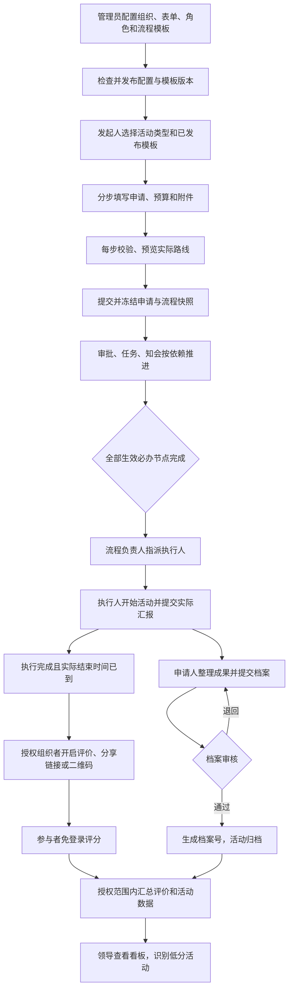
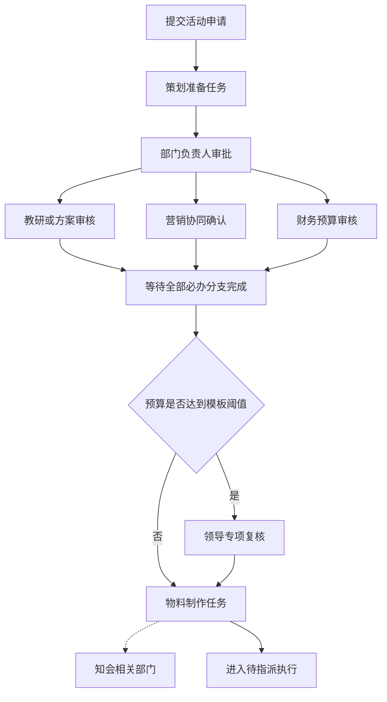
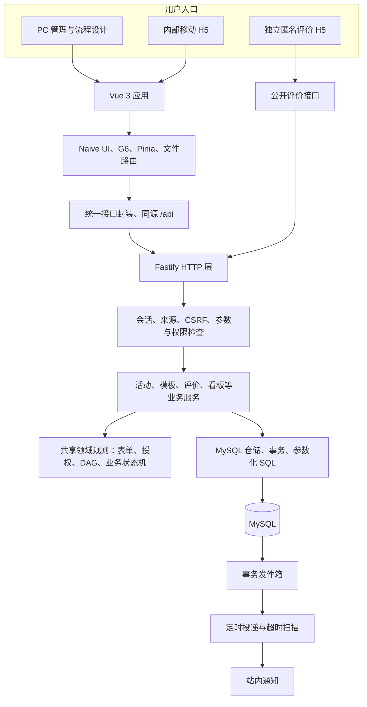
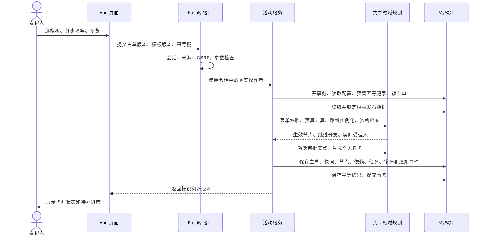
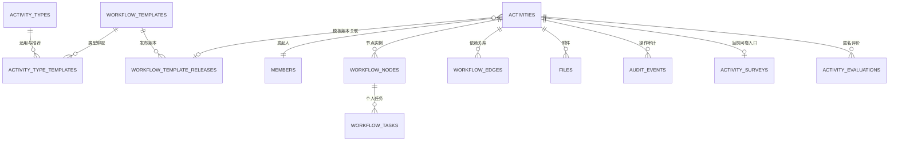
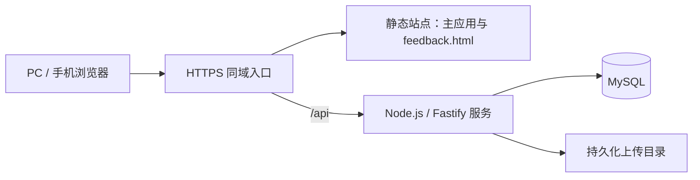

# 活动流程 ERP：产品与技术流程汇报

汇报口径：2026 年 10 月 23 日项目当前源码。适用对象：公司领导、业务部门负责人、产品与研发团队。

## 1. 项目定位与目标

本项目是一套面向公司内部活动协作的轻量系统，把活动申请、跨部门审核、任务办理、执行汇报、成果归档和活动评价连接起来，并为领导提供统一的数据看板。

系统围绕“每场活动一张工单”组织数据，通过可配置的表单和流程模板适应不同活动场景。业务人员主要使用 PC 和移动 H5；配置管理员在 PC 上维护流程、组织和权限。

| 当前业务问题 | 产品解决方式 | 汇报时强调的价值 |
| --- | --- | --- |
| 活动资料分散在表格、聊天和附件中 | 工单集中保存申请、资料、流程和成果 | 一场活动的信息和历史集中查阅 |
| 不同活动需要不同审批路线 | 按活动类型选择已发布流程模板 | 常用流程复用，特殊活动单独配置 |
| 多部门协作难判断谁先办、谁没办 | 串行、并行、条件分支和个人待办 | 责任人、当前进度、下一步清楚可见 |
| 财务和其他敏感内容需要隔离 | 活动范围、节点资料、字段和附件分别授权 | 协作共享进度，敏感资料按需开放 |
| 审批通过后缺少执行追踪 | 指派、执行、汇报、档案审核形成闭环 | 从申请一直追踪到执行结果 |
| 活动质量难持续衡量 | 免登录评价与领导看板 | 同时观察活动数量、完成情况与反馈质量 |

当前范围为单公司内部协作。财务节点可以参与审核并上传受限资料；财务核算、付款、报销、库存台账和采购合同管理留给专门业务系统。

## 2. 产品结构与角色分工

### 2.1 产品模块

| 模块 | 主要能力 | 主要使用人 |
| --- | --- | --- |
| 工作台 | 活动概览、近期活动、快捷入口、站内消息 | 内部成员 |
| 活动工单 | 查询、筛选、发起人展示、详情、附件和授权导出 | 发起人、相关部门 |
| 发起活动 | 活动类型和模板选择、分步动态表单、草稿、实际路线预览 | 活动发起人 |
| 我的待办 | 审批、任务完成、退回、拒绝及办理记录 | 节点受理人 |
| 活动执行与档案 | 指派执行人、执行汇报、成果提交、档案审核 | 流程负责人、执行人、档案审核人 |
| 活动评价 | 链接、二维码、匿名评分、反馈和问卷开关 | 组织者、执行与档案岗位、活动参与者 |
| 领导看板 | 活动总量、完成情况、人次、评分、趋势和低分关注 | 公司或部门领导 |
| 配置中心 | 动态表单、流程模板、组织成员、角色权限、菜单页面 | 配置管理员 |

PC 适合配置、集中管理和多栏查阅；移动 H5 适合发起、待办办理、查看进度和现场操作。流程编排在 PC 完成。参与者评价使用独立 H5 页面，无需内部账号。

### 2.2 角色分工

| 角色 | 主要职责 | 授权原则 |
| --- | --- | --- |
| 配置管理员 | 维护组织、表单、模板、菜单和角色 | 配置、业务数据、敏感资料分别授权 |
| 活动发起人 | 创建工单、提交申请、补充资料、整理成果 | 以本人活动及授予范围为主 |
| 部门负责人 | 审核部门活动，或按模板承担其他职责 | 按部门及下级范围授权 |
| 专项审核人 | 教研、财务、策划、营销、印刷等专项审核 | 按受理规则参与节点，资料另行控制 |
| 任务受理人 | 准备材料、协调资源、完成专项事项 | 具备任务办理与相应活动访问权限 |
| 知会接收人 | 接收业务进度通知 | 资料读取继续执行独立授权 |
| 流程负责人 | 协调异常、在途加签、转交待办、指派执行人 | 必须同时具备操作权限和管理范围 |
| 活动执行人 | 开始执行、提交实际时间、人数、费用及总结 | 处理指派给自己的活动 |
| 档案审核人 | 核查成果资料，通过或退回 | 独立归档审核，禁止自审 |
| 领导 | 查看范围内汇总，按需查阅敏感资料 | 看板权限和敏感原文权限分别分配 |
| 外部评价人 | 扫码或打开链接评分 | 仅访问问卷所需的最少活动信息 |

一个成员可以兼任多个角色。组织预置支持财务、策划、营销、设计、印刷制作、采购、仓储物流、行政人事和客户服务等部门，实际人员及职责以公司发布配置为准。

## 3. 产品端到端业务流程



需要区分三个时点：

1. **流程办理完成**：本模板的审批和任务已结束，活动进入待指派。
2. **执行完成**：执行人提交汇报，活动进入档案阶段；满足实际结束时间后可开启评价。
3. **活动归档**：成果资料通过档案审核，形成正式档案。

评价收集与档案整理可以并行，不必等到归档才收集反馈。

## 4. 动态表单与多流程模板

### 4.1 配置流程


### 4.2 模板选择规则

| 配置项 | 作用 |
| --- | --- |
| 活动类型 | 对活动分类，并筛选可用流程模板 |
| 适用活动类型 | 决定该模板可以用于哪些活动类型 |
| 默认推荐类型 | 在适用范围内，决定哪些类型优先推荐该模板 |
| 部门和角色范围 | 决定哪些申请人可以使用模板 |
| 模板版本 | 固定本次申请采用的流程定义与发布时表单 |

例如，“线上公益研讨”可以只适用于线上研讨；某类活动同时有多个适用模板时，可以将常用模板设为默认推荐。默认推荐类型必须属于适用类型；同一类型在重叠部门覆盖范围内的默认模板会进行冲突检查。

**当前表单能力口径：**公司维护一套动态申请表，不同流程模板发布时冻结该表单。多流程模板负责路线差异；“每种活动独立设计一整套表单模板”可作为后续扩展。

表单支持字段配置、条件显隐、必填校验和费用计算。点击下一步先校验当前步骤，提交时服务端再次校验；预算由费用明细计算，防止仅修改合计值。

### 4.3 节点类型与执行顺序

| 节点 | 行为 | 是否等待人工完成 |
| --- | --- | --- |
| 系统开始 | 提交后启动没有前置的业务节点 | 系统触发，无受理人 |
| 审批 | 同意、退回或拒绝；多人全员同意才通过 | 是 |
| 任务 | 提交办理结果；多人全部完成才继续 | 是 |
| 知会 | 到达时点后自动完成并写入通知队列 | 否 |
| 系统完成 | 生效审批、任务全部结束后进入待指派 | 系统计算 |

首个业务节点可以是审批、任务或知会，旧模板草稿中的默认部门初审也可以修改或删除。纯任务模板等待任务完成；纯知会模板提交后通知并进入待指派。空草稿允许保存，发布至少需要一个合法业务节点。

画布默认纵向，也可横向。**执行顺序由前置依赖决定，拖动位置只改变布局。**多个无前置节点并行启动；后继等待全部阻断前置完成。条件未命中会跳过该节点并继承有效前置；全部节点均被条件跳过时阻止提交。

知会的具体含义：`审批 A → 知会 B → 任务 C` 中，A 完成后 B 自动知会，C 同时具备进入条件，系统不等待通知被阅读。

新建或复制草稿后默认进入 PC 全屏设计器，节点库、画布、属性面板同时展示；支持前插、后插、并行新增、连线、节点定位、自动排列、删除和撤销。

### 4.4 跨部门流程示例

下图是可配置业务示例，财务、印刷等节点按具体活动需要加入。



预置标准教研路线采用部门初审、教研与营销并行，并按预算条件增加负责人复核；实际路线以申请选中的已发布模板和本次条件计算结果为准。

## 5. 业务状态与异常处理

### 5.1 活动主单状态

| 阶段 | 状态 | 进入下一步的关键条件 |
| --- | --- | --- |
| 申请准备 | 草稿、待补充、已撤回 | 完成校验并重新提交 |
| 节点办理 | 流程办理中 | 生效审批通过、任务完成 |
| 执行安排 | 待指派 → 待执行 | 授权负责人指定执行人 |
| 现场执行 | 执行中 | 到计划时间后人工开始，随后提交实际汇报 |
| 成果归档 | 待提交档案 → 待归档审核 → 已归档 | 成果资料齐全，独立审核通过 |
| 取消处理 | 取消审批中 → 已取消，或恢复原状态 | 授权审核人决定，申请人可撤销取消申请 |
| 审批终止 | 已拒绝 | 本轮终止，可按业务入口复制新申请 |

“删除”是独立逻辑删除标记，记录删除时间、操作者与原因，并非新增一个业务流转状态。

### 5.2 关键异常

| 异常 | 当前处理方式 |
| --- | --- |
| 审批退回 | 进入待补充，取消本轮剩余待办；补充后生成新申请轮次 |
| 审批拒绝 | 进入已拒绝，终止本轮办理并保留历史 |
| 申请撤回 | 在允许状态内撤回，使原待办失效 |
| 临时增加事项 | 授权流程负责人在办理中前插、后插、并行加签，校验影响范围 |
| 受理人离岗、停用或需要替换 | 转交给有当前权限及数据范围的人员，记录原因 |
| 节点已完成后尝试前插 | 阻止需要回溯已完成环节的调整 |
| 发起取消 | 暂停后续业务动作；拒绝或撤销后恢复取消前状态 |
| 待办超时 | 按自然时长 24 小时提醒、48 小时升级至有管理范围的流程负责人 |
| 重复点击、网络重试 | 幂等请求返回首次处理结果，版本冲突提示刷新 |
| 删除活动 | 按权限逻辑删除，取消待办、关闭评价入口、保留关联历史 |

发起人可删除本人草稿、待补充、已撤回、已拒绝或已取消活动；具有任意活动删除权限的管理员可在该权限对应范围内删除其他状态活动。

## 6. 数据权限：共享进度，按需开放资料

权限分为四个层面：页面能否进入、操作能否执行、活动范围能否覆盖、资料原文能否读取。服务端对详情、历史、附件和导出统一执行授权。

| 层面 | 控制内容 | 示例 |
| --- | --- | --- |
| 页面权限 | 菜单、页面和业务模块 | 财务看待办，配置管理员进入模板设计 |
| 操作权限 | 审批、任务、指派、加签、删除、导出等 | 能看流程的人需要另有权限才能加签 |
| 活动数据范围 | 本人、本部门、部门及下级、参与活动、全公司 | 部门领导查看本部门及下级活动 |
| 内容权限 | 节点内部说明、字段原文、编辑资格、附件查看与下载 | 营销可见财务已通过，但财务依据仅授权人员可读 |

财务场景：营销人员看到财务节点进度与公开结论；财务受理人看到本节点内部说明和受限附件；总负责人获得范围内敏感查看权限后可以查阅全部敏感资料。下载和敏感导出另有授权。

领导看板提供聚合指标，不返回预算、联系人、财务明细和内部审批原文。多个角色的敏感权限与数据范围绑定判断，避免把“全公司普通查看”和“本部门敏感查看”组合成全公司敏感阅读。

模板节点权限随实例冻结；实时人员启停和授权撤销仍重新校验。申请字段读取同时执行历史约束和当前发布约束，当前收紧规则覆盖旧数据。接口返回前过滤或脱敏，附件直链重新鉴权。

## 7. 活动评价与领导看板

### 7.1 评价流程


评价维度为整体满意度、内容质量、组织服务、实际收获，均为 1～5 星；建议为可选文本。组织者可以停止收集、更换链接；换码后旧链接失效，既有评价保留。

当前按同一浏览器、同一活动去重，属于匿名反馈采集；如需限定受邀人员或实名唯一，需要增加邀请身份机制。

### 7.2 指标口径

| 指标 | 当前计算口径 |
| --- | --- |
| 查询时间 | 活动计划开始日期；默认近 90 天，单次最多 366 天 |
| 活动总量 | 授权范围内、符合筛选、非草稿且未删除的活动，包含拒绝和取消 |
| 执行完成数 | 待提交档案、待归档审核、已归档的活动数 |
| 完成率 | 执行完成数 ÷ 活动总量 |
| 实际参与 | 已执行完成活动的实到人数合计，单位人次 |
| 整体均分 | 整体评分总和 ÷ 评价份数，按份数加权 |
| 满意率 | 整体评分 4～5 星份数 ÷ 评价份数 |
| 低分反馈 | 整体评分 1～2 星 |
| 需关注活动 | 整体均分低于 3.5 分，显示样本量，最多展示 10 场 |

无评价时，均分和比例显示“—”。看板包含月度趋势、流程状态分布、部门比较、活动类型分布和低分关注列表，全部使用同一授权与筛选范围。

## 8. 技术架构

系统采用前后端分离的模块化单体架构，通过共享领域包统一表单、权限和流转规则。流程引擎直接嵌入 Node.js 服务；通知通过 MySQL 事务发件箱可靠投递。



公开评价接口使用指定公开路由豁免内部账号会话和内部 CSRF，仍校验请求来源、公开令牌、匿名 Cookie 和限流。

| 层级 | 当前项目选择 | 承担职责 |
| --- | --- | --- |
| 前端 | Vue 3、TypeScript/TSX、Vite、Naive UI | PC/H5 页面和交互 |
| 状态与路由 | Pinia、Vue Router 文件路由、VueUse | 会话、页面状态、导航、响应式布局 |
| 图形 | AntV G6 5 | 组织图、模板设计、预览和运行进度图 |
| 服务端 | Node.js 24+、Fastify 5、Zod | HTTP、参数校验、业务编排 |
| 数据层 | mysql2、MySQL；提供 MySQL 8.4 容器配置 | 事务、关联索引、业务历史 |
| 工程 | pnpm workspace、Vitest、Prettier | 分包、局部校验和代码规范 |

版本依据项目依赖清单描述，具体锁定值可查看各 package.json。

### 8.1 代码职责划分

```text
apps/web/src/
  pages/         文件路由入口，保持轻薄
  views/         页面数据加载和业务编排
  components/    列表、表单、设计器、图形、详情和抽屉
  api/           按业务拆分接口封装
  navigation/    集中维护路径与菜单映射
  stores/        会话和配置状态

apps/server/src/
  app.ts         应用注册、认证钩子及主要 HTTP 接口
  routes/        模板、评价与看板接口
  services/      活动、配置、模板、权限资料、评价等业务编排
  db/            仓储、建表、迁移、就绪检查

packages/domain/src/
  表单与类型、权限与数据投影、模板校验、DAG 流转、业务状态机
```

动态菜单使用“服务端发布页面配置 + 本地可信组件注册表”。新增菜单可以复用已有业务视图；新增业务组件仍需研发实现。配置内容不直接执行任意页面脚本。

## 9. 技术核心：从模板到真实待办

### 9.1 定义、实例与任务

- **模板定义**：可复用节点、条件、前置关系、受理规则和资料权限。
- **活动实例**：本场活动提交时固定的实际路线，记录模板版本和申请轮次。
- **节点实例**：该活动的真实办理节点，具有状态与 generation 轮次。
- **个人任务**：一个节点下每位受理人各一条任务，独立版本校验。

流程节点采用 `deps` 前置列表，形成有向无环图。A、B 都没有前置时同时激活；C 的前置为 A、B 时，两者都完成才激活 C。审批和任务采用全员完成策略。

### 9.2 提交申请的服务端流程



相同操作者使用相同幂等键重试时，返回首次结果；同一键对应不同内容返回冲突。任一步失败，事务回滚。

### 9.3 完成一次审批后的推进

1. 依据个人任务找到活动，在事务中锁定活动并读取实时组织权限。
2. 检查当前受理人、任务版本、节点轮次、活动状态与禁止自审规则。
3. 保存本人的审批或任务办理结果；退回、拒绝则终止本轮并使其他未办任务失效。
4. 同意或完成时，检查本节点所有受理人是否都已完成。
5. 节点完成后检查后继前置条件，激活可办理节点；知会自动完成并写入通知事件。
6. 全部生效必办节点完成后，把活动置为待指派。
7. 主单、任务、审计、通知事件和幂等结果一起提交。

### 9.4 并发与版本控制

| 控制项 | 解决的问题 |
| --- | --- |
| 主单行锁与数据库事务 | 同一活动的结构、任务和状态一致保存 |
| 主单 version | 防止旧页面覆盖新的指派、撤回、执行等结果 |
| 个人任务 version | 并行节点各自办理，重复或过期决定被拦截 |
| structureRevision | 防止多人同时加签覆盖结构 |
| 节点 generation | 前插等调整后，旧轮次待办失效 |
| 模板版本与发布指针锁 | 防止预览后模板更新，提交却悄悄采用另一版本 |
| 草稿版本 | 防止多人编辑配置或模板互相覆盖 |
| 幂等键与请求摘要 | 防止网络重试重复提交，阻止同一键用于不同请求 |

提交时冻结表单、输入、原模板定义与版本；运行节点保存实例调整。新模板发布用于后续选择与提交，在途活动继续使用原快照；实时授权撤销和人员停用仍生效。

## 10. 数据模型、通知和部署

### 10.1 数据模型



图表示业务关联；实际外键以 schema.sql 和增量迁移为准。组织、角色、菜单由发布配置物化；业务主单保存可演进的 JSON 内容，节点与任务等独立保存以支持授权查询和待办索引。

| 数据类别 | 主要表 |
| --- | --- |
| 公司配置与历史 | configuration、configuration_releases |
| 组织账号与权限 | departments、members、roles、menu_pages、sessions |
| 模板目录与版本 | activity_types、workflow_templates、workflow_template_releases、activity_type_templates |
| 活动运行 | activities、workflow_nodes、workflow_edges、workflow_tasks |
| 文件与审计 | files、audit_events |
| 可靠写入与消息 | idempotency_records、outbox_events、notifications |
| 活动反馈 | activity_surveys、activity_evaluations |
| 结构演进 | schema_migrations |

### 10.2 通知与账号安全

业务事务先写 outbox_events；服务进程每 10 秒尝试投递为站内消息，失败后重试，并用唯一事件键去重。超时扫描每分钟执行，按 24/48 自然小时提醒和升级。通知承担提醒作用，审批决定仍由授权人员办理。

账号使用服务端会话和 HttpOnly Cookie；密码采用随机盐 scrypt 哈希。写接口检查来源与 CSRF，文件读取重新鉴权；日志对会话凭据做隐藏处理。公开评价有独立令牌、匿名 Cookie、去重和限流。

### 10.3 部署形态



建议按当前模块化单体方案部署：静态站点负责页面与 history 路由回退，API 反向代理到 Node.js 服务；MySQL 与上传目录持久化。数据库可以使用本机实例或项目提供的 MySQL 容器配置。

公开评价域名须能被参与者手机访问，并正确配置同源 API 和 PUBLIC_APP_URL。当前通知在 API 进程内定时处理；多实例部署时应补充扫描任务协调、统一限流和文件共享方案。

## 11. 当前成果、验收与下一步

### 11.1 当前代码覆盖

已覆盖活动申请、模板选择、分步校验、流程设计、串并行与条件流转、加签与转交、执行归档、权限隔离、评价、看板和逻辑删除；前后端已有接口对接。

本次汇报依据源码和已有实施文档整理，未启动项目、数据库或浏览器，也未重新执行测试。上线验收以实际环境的全角色联调结果、数据核对和业务签字为准。

### 11.2 重点验收清单

| 验收主题 | 建议演示或核对内容 |
| --- | --- |
| 模板适配 | 同一活动类型选不同模板；不同类型推荐不同路线 |
| 节点自由编排 | 首节点切换审批、任务、知会；保存、发布；检查空模板限制 |
| 串并行正确性 | 前置未全部完成时后继不激活，多人节点全员完成 |
| 异常与并发 | 退回重提、前插加签、转交、重复请求、过期版本 |
| 财务隔离 | 普通协作者看进度；财务看本节点；领导按敏感授权查原文 |
| 执行闭环 | 指派、开始、实际汇报、成果提交、档案退回及通过 |
| 活动评价 | 执行完成后开码、免登录提交、重复去重、关闭和换码 |
| 看板口径 | 部门范围、完成数、样本量、均分和满意率核对 |
| 删除与历史 | 删除后列表和看板排除，待办终止，历史关联保留 |

### 11.3 下一步工作优先级

| 优先级 | 工作 | 需要确认的业务问题 |
| --- | --- | --- |
| P0 | 完成全角色业务验收 | 正式角色名单、管理范围、敏感资料受众、标准模板 |
| P0 | 明确发布运维方案 | 访问域名、HTTPS、备份恢复、附件保留周期、生产账号策略 |
| P1 | 模板治理 | 哪些活动必须财务或领导审核，预算门槛及替代审核人规则 |
| P1 | 反馈处理闭环 | 低分由谁处理，是否需要任务、回访和处理结论 |
| P2 | 企业集成 | 企业微信/钉钉登录和消息、组织同步 |
| P2 | 配置扩展 | 独立表单模板、工作日 SLA、批准后正式变更及更丰富节点策略 |

建议试运行后衡量申请平均耗时、节点逾期率、退回补充率、执行完成率、归档及时率、评价覆盖率与满意率，再形成改进目标；当前汇报不填造尚未测得的效率提升数据。

## 12. 建议汇报顺序与演示脚本

### 12.1 10 页汇报提纲，约 10～12 分钟

| 页 | 主题 | 核心讲述 | 建议画面 |
| --- | --- | --- | --- |
| 1 | 项目定位 | 一场活动一张工单，贯通申请到反馈 | 项目首页与定位 |
| 2 | 业务问题与价值 | 资料、责任、协作、保密和效果衡量 | 第 1 节价值表 |
| 3 | 产品全流程 | 配置、申请、办理、执行、归档、评价 | 第 3 节业务流程图 |
| 4 | 多模板和节点设计 | 不同活动选不同路线，首节点类型自由 | 全屏设计器与第 4 节示例 |
| 5 | 角色与权限 | 共享进度，敏感原文按需授权 | 财务、营销、领导三个视角 |
| 6 | 执行、评价与看板 | 审批后持续追踪，数量与质量一起看 | 详情、匿名评价 H5、领导看板 |
| 7 | 技术架构 | Vue + Node + MySQL，领域规则集中 | 第 8 节架构图 |
| 8 | 流转与可靠性 | 模板实例化、个人待办、事务、版本、幂等 | 第 9 节时序图 |
| 9 | 当前成果和验收 | 已有代码范围，全角色业务验收重点 | 第 11 节清单 |
| 10 | 下一步与决策 | 确定模板治理、正式授权和上线运维 | 优先级及待确认事项 |

### 12.2 现场演示建议

1. 管理员新建模板，选择首个业务节点，进入全屏设计；加入并行审核、条件和一个任务。
2. 查看财务节点的数据权限；检查并发布模板。
3. 发起人选择活动类型和模板；演示当前步骤校验、路线预览和提交。
4. 不同节点角色分别办理；先完成一个并行分支，展示后继仍在等待，再完成另一分支。
5. 如需演示异常，使用另一张活动演示退回补充或加签，避免干扰主流程样例。
6. 流程负责人指派执行人；执行人提交符合时间规则的真实演示汇报。
7. 展示档案提交、审核与归档；开启评价，手机扫码提交一份反馈。
8. 切换领导身份，展示范围内看板及评价样本；切换普通协作者，展示受限资料隔离。

演示前准备完整账号、可用附件、已执行完成的活动和评价样本。涉及开始时间校验的环节按业务规则安排，准备历史完整样例承接现场难以等待的阶段。

### 12.3 开场讲述示例

“我们做的是公司内部活动协作系统。每场活动从申请开始，就有一张完整工单，把跨部门审核、准备任务、执行记录和成果资料连起来。不同活动可以选择不同流程模板，部门只处理自己负责的事项，财务等敏感资料按权限开放。活动执行完成后，再通过匿名评价和领导看板观察效果。今天重点汇报业务如何闭环、流程如何配置，以及系统如何保证权限和流转正确。”

## 附录：本次核对的主要依据

- `apps/web/package.json`、`apps/server/package.json`：项目技术依赖。
- `apps/web/src/components/templates/`：模板目录、全屏设计器、节点规则及申请选择。
- `apps/web/src/main.ts`、`apps/web/vite.config.ts`、`apps/web/src/navigation/`：文件路由、前端入口和导航。
- `apps/web/src/views/workspace/view-registry.ts`：动态页面可信组件注册表。
- `packages/domain/src/templates.ts`、`workflow.ts`、`business.ts`：模板校验、节点实例化和业务动作。
- `packages/domain/src/permissions.ts`、`data-access.ts`、`data-projection.ts`：活动范围、敏感资料、字段投影与附件授权。
- `apps/server/src/services/activity-service.ts`、`template-service.ts`：活动提交、事务、版本和幂等编排。
- `apps/server/src/services/evaluation-service.ts`、`dashboard-service.ts`、`routes/insights.ts`：公开评价与领导看板。
- `apps/server/src/services/activity-deletion-service.ts`、`reminder-service.ts`、`main.ts`：删除、提醒与定时投递。
- `apps/server/src/db/schema.sql`、增量迁移、`compose.yaml`：数据结构与部署配置。
- `docs/流程模板自由编排实施说明.md`、`活动评价与领导看板PRD.md`、`数据权限配置与验收.md`：当前业务规则补充。
